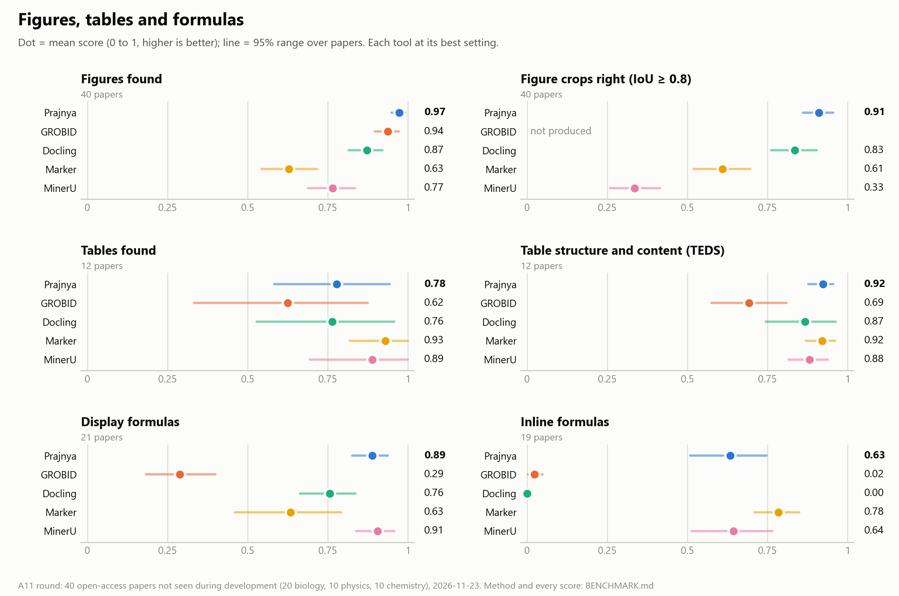
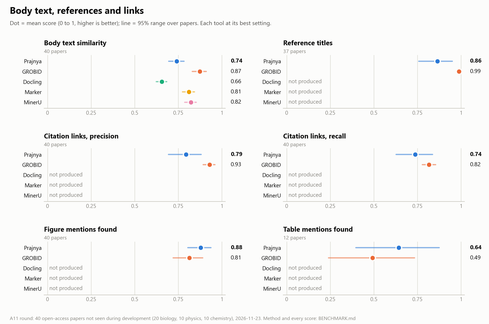
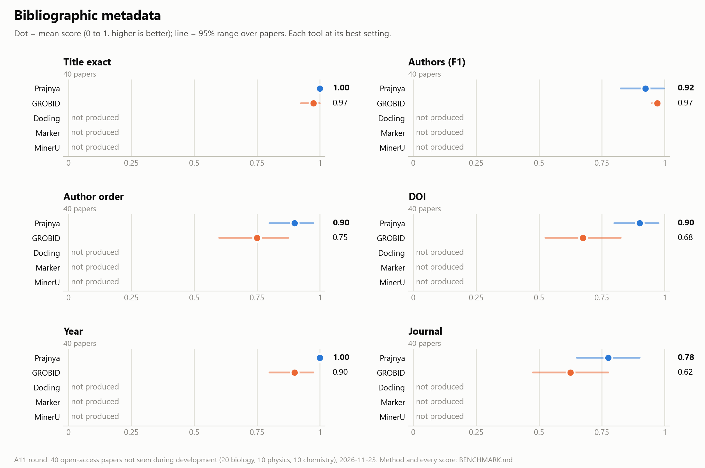
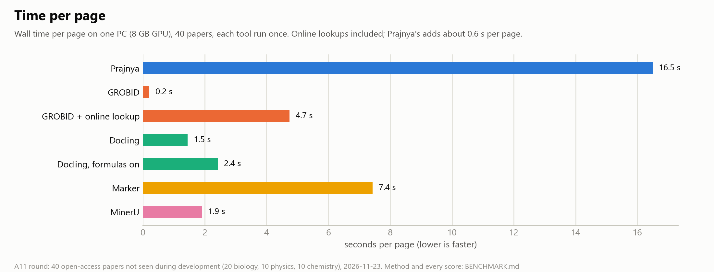
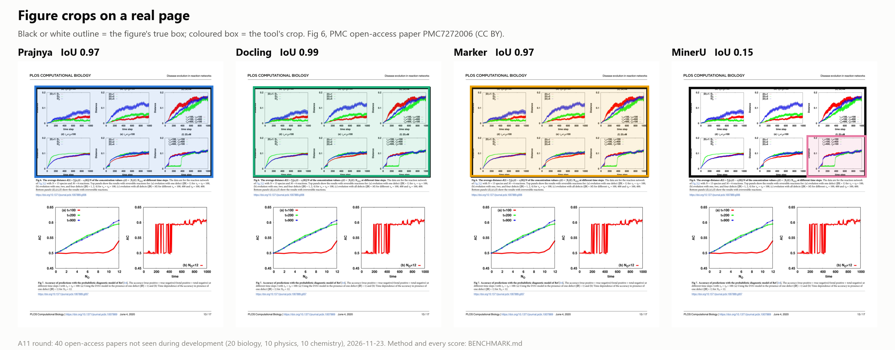

# Prajnya benchmark

How Prajnya and four other open-source tools turn scientific PDFs into
structured data, measured on research articles whose correct answer is
published by the publisher. Nobody labelled anything by hand.

There have been two rounds, each on its own set of papers drawn blind, after
the protocol and the scoring code were fixed. They are reported separately
and never pooled.

| round | Prajnya | papers | fields | new measures |
|---|---|---|---|---|
| [Round 2](#round-2-v690-2026-11-23) | v6.9.0 | 40 | biology, physics, chemistry | figure crops, formulas |
| [Round 1](#round-1-v670-2026-11-20) | v6.7.0 | 40 | biology | (first round) |

## Round 2: v6.9.0, 2026-11-23

### At a glance

Each dot is a tool's mean score over the papers that have the item (0 to 1,
higher is better); the line through it is the 95% range of that mean,
resampling the papers. Where two tools' lines overlap a lot, the gap between
them could be chance. Each tool is shown at its best setting for each measure
(Prajnya `local` or `online`, GROBID with or without consolidation, Docling
with or without its formula reader); every setting is in the
[full tables](#full-tables).

<picture>
  <source media="(prefers-color-scheme: dark)" srcset="benchmark/plots/compare_figures_tables_formulas_dark.png">
  
</picture>

<picture>
  <source media="(prefers-color-scheme: dark)" srcset="benchmark/plots/compare_text_references_links_dark.png">
  
</picture>

<picture>
  <source media="(prefers-color-scheme: dark)" srcset="benchmark/plots/compare_metadata_dark.png">
  
</picture>

<picture>
  <source media="(prefers-color-scheme: dark)" srcset="benchmark/plots/compare_speed_dark.png">
  
</picture>

**A figure crop, on a real page.** The page is chosen by a fixed rule, not
by eye: among the figures every cropping tool cropped, the one whose Prajnya
crop is closest to Prajnya's median crop. It shows a typical crop, not a
favourable one.

<picture>
  <source media="(prefers-color-scheme: dark)" srcset="benchmark/plots/compare_crops_dark.png">
  
</picture>

### What is new in this round

- **Three fields.** 20 biology papers (5 each in biochemistry, biophysics,
  developmental biology and computational biology), 10 physics and 10
  chemistry, from seven journals.
- **Figure crops.** Each figure's true box is found by matching the
  publisher's own image of the figure against the rendered PDF page; each
  tool's crop is compared with it.
- **Formulas.** Display and inline formulas, against the publisher's MathML.
- Prajnya v6.9.0 (output contract 1.6) in place of v6.7.0. The other tools
  are the same versions as in round 1.

### Method

The answer key, the text clean-up and the definitions of every measure
carried over from round 1 are as in [round 1's method](#method-1). Only what is
new or different is listed here; the full protocol is
[`benchmark/PROTOCOL.md`](benchmark/PROTOCOL.md) (amendments A11 and A12).

**Corpus.**

| | |
|---|---|
| Papers | 40 research articles, published 2018–2025, CC BY, from the PMC Open Access subset |
| Fields | a paper's field is the publisher's own subject label: biochemistry 5, biophysics 5, developmental biology 5, computational biology 5, physics 10, chemistry 10 |
| Journals | Nature Communications 9, PNAS 9, Science Advances 6, Scientific Reports 6, PLOS Computational Biology 5, Frontiers in Chemistry 3, Nature 2 |
| Selection | at random, with a fixed seed (`20261123`), from every eligible paper of each journal and field; papers used in Prajnya's development or in round 1 are excluded |
| Size | 509 pages; 249 figures; 20 tables (in 12 papers); 127 display and 719 inline formulas; 2,320 references |

**Tools.**

| configuration | version | licence | network |
|---|---|---|---|
| Prajnya `local` | v6.9.0 (output contract 1.6), llama.cpp b12035 | Apache-2.0 | none |
| Prajnya `online` | same, `--citations online` | | sends the DOI or title to Crossref and OpenAlex |
| GROBID | 0.9.1, CPU | Apache-2.0 | none |
| GROBID consolidated | 0.9.1, header and citation consolidation on | | sends extracted fields to Crossref |
| Docling | 2.151.1, default settings | MIT | none |
| Docling, formulas on | 2.151.1, `--enrich-formula` (amendment A12) | | none |
| Marker | marker-pdf 2.2.0, without the LLM option | Apache-2.0 (code; model weights under their own licence) | none |
| MinerU | 4.2.3 | MinerU Open Source License | none |
| Raw text layer | the PDF's own text, page by page (no tool) | | none |

Settings, as in round 1, are listed in
[`benchmark/tools.lock.md`](benchmark/tools.lock.md).

**Docling's formula reader (amendment A12).** Docling's formula reader is
off by default, and the round's protocol ran every tool at its round-1
settings, so Docling first scored 0 on formulas. That measured a setting,
not what Docling can do. After the scores had been seen, Docling was run
again on the same papers with the reader on. Both runs are reported; they
differ only in the formula scores and the time.

**New measures.**

- **Crop IoU:** the overlap of a tool's crop with the figure's true box,
  divided by the area the two cover together (intersection over union). 1
  is a perfect crop. A figure cropped in several pieces is scored on the box
  around all of them.
- **Crop right:** the share of figures whose crop has an IoU of at least
  0.8.
- A figure's true box is found by sliding the publisher's figure image over
  the page at many sizes; a match below 0.6 counts as "not located" and the
  figure is left out for every tool. 2 of the 249 figures were not located.
  The threshold was fixed on 10 pilot papers, checked by eye, before any
  tool was scored.
- **Display and inline formulas:** each formula is reduced to a sequence of
  symbols (letters, numbers, operators), a tool's LaTeX being converted to
  MathML first, and compared with the key's: 1 minus the edit distance over
  the longer sequence. A tool's formulas are matched to the key's by their
  position in the text. A paper counts only when it has a formula of that
  kind. A tool that marks no formula as such scores 0 on it.

### Full tables

The number after each measure is the papers behind the mean (those that
have the item). `n/s`: the tool does not produce it.

#### Metadata

| | Prajnya local | Prajnya online | GROBID | GROBID consol. |
|---|---|---|---|---|
| title exact (40) | 1.000 | 1.000 | 0.897 | 0.975 |
| authors found (surname F1) (40) | 0.897 | 0.922 | 0.911 | 0.970 |
| author list exact, in order (40) | 0.725 | 0.900 | 0.550 | 0.750 |
| DOI (40) | 0.750 | 0.900 | 0.675 | 0.675 |
| year (40) | 1.000 | 1.000 | 0.550 | 0.900 |
| journal (40) | 0.750 | 0.775 | 0.000 | 0.625 |

#### Body text

| | text layer | Prajnya local | Prajnya online | GROBID | GROBID consol. | Docling | Docling formulas | Marker | MinerU |
|---|---|---|---|---|---|---|---|---|---|
| paragraphs found (coverage) (40) | 0.823 | 0.889 | 0.889 | 0.891 | 0.891 | 0.917 | 0.917 | 0.881 | 0.870 |
| text similarity (40) | 0.544 | 0.741 | 0.741 | 0.874 | 0.874 | 0.656 | 0.656 | 0.812 | 0.824 |
| reading order (Kendall τ) (40) | 0.990 | 0.995 | 0.995 | 0.994 | 0.994 | 0.993 | 0.993 | 0.993 | 0.995 |

#### Figures

| | Prajnya local | Prajnya online | GROBID | GROBID consol. | Docling | Docling formulas | Marker | MinerU |
|---|---|---|---|---|---|---|---|---|
| found under its printed label (40) | 0.973 | 0.973 | 0.938 | 0.938 | 0.873 | 0.873 | 0.629 | 0.766 |
| found by label or by caption (40) | 0.973 | 0.973 | 0.959 | 0.959 | 0.882 | 0.882 | 0.629 | 0.918 |
| kept in one piece (40) | 0.973 | 0.973 | 0.926 | 0.926 | 0.873 | 0.873 | 0.629 | 0.766 |
| caption similarity (40) | 0.874 | 0.874 | 0.903 | 0.903 | 0.848 | 0.848 | 0.834 | 0.886 |
| crop right (IoU ≥ 0.8) (40) | 0.911 | 0.911 | n/s | n/s | 0.835 | 0.835 | 0.610 | 0.335 |
| crop IoU (40) | 0.907 | 0.907 | n/s | n/s | 0.837 | 0.837 | 0.591 | 0.424 |

#### Tables

| | Prajnya local | Prajnya online | GROBID | GROBID consol. | Docling | Docling formulas | Marker | MinerU |
|---|---|---|---|---|---|---|---|---|
| found under its printed label (12) | 0.778 | 0.778 | 0.625 | 0.625 | 0.764 | 0.764 | 0.931 | 0.889 |
| TEDS (cells and structure) (12) | 0.923 | 0.923 | 0.692 | 0.692 | 0.867 | 0.867 | 0.920 | 0.881 |
| TEDS-S (structure only) (12) | 0.982 | 0.982 | 0.787 | 0.787 | 0.905 | 0.905 | 0.951 | 0.930 |

#### Formulas

| | Prajnya local | Prajnya online | GROBID | GROBID consol. | Docling | Docling formulas | Marker | MinerU |
|---|---|---|---|---|---|---|---|---|
| display formulas (21) | 0.889 | 0.889 | 0.289 | 0.289 | 0.000 | 0.757 | 0.635 | 0.906 |
| inline formulas (19) | 0.634 | 0.634 | 0.022 | 0.022 | 0.000 | 0.000 | 0.784 | 0.643 |

#### References

| | Prajnya online | GROBID | GROBID consol. | MinerU |
|---|---|---|---|---|
| entries found (40) | 0.996 | 0.989 | 0.951 | 0.994 |
| precision (40) | 0.996 | 0.982 | 0.944 | 0.995 |
| title right (37) | 0.864 | 0.988 | 0.978 | n/s |
| year right (37) | 0.999 | 0.993 | 0.998 | n/s |
| DOI right (40) | 0.812 | 0.240 | 0.847 | n/s |
| first author right (40) | 0.986 | 0.985 | 0.985 | n/s |

#### In-text links

| | Prajnya local | Prajnya online | GROBID | GROBID consol. |
|---|---|---|---|---|
| citations: precision (40) | n/s | 0.795 | 0.930 | 0.897 |
| citations: recall (40) | n/s | 0.736 | 0.816 | 0.785 |
| figure mentions: precision (40) | 0.870 | 0.870 | 0.714 | 0.714 |
| figure mentions: recall (40) | 0.880 | 0.880 | 0.815 | 0.815 |
| table mentions: precision (11) | 0.773 | 0.773 | 0.660 | 0.660 |
| table mentions: recall (12) | 0.642 | 0.642 | 0.492 | 0.492 |

#### By field

Each tool at its best setting for each measure. The number after a field is
its papers; for tables and formulas only those with the item count.

| | field | Prajnya | GROBID | Docling | Marker | MinerU |
|---|---|---|---|---|---|---|
| figures found | biology (20) | 0.964 | 0.924 | 0.843 | 0.528 | 0.729 |
| figures found | physics (10) | 1.000 | 0.964 | 0.876 | 0.802 | 0.926 |
| figures found | chemistry (10) | 0.963 | 0.941 | 0.930 | 0.659 | 0.680 |
| crop right | biology (20) | 0.932 | n/s | 0.844 | 0.515 | 0.355 |
| crop right | physics (10) | 0.950 | n/s | 0.836 | 0.802 | 0.303 |
| crop right | chemistry (10) | 0.829 | n/s | 0.816 | 0.606 | 0.327 |
| table TEDS | biology (20) | 0.904 | 0.820 | 0.839 | 0.925 | 0.907 |
| table TEDS | physics (10) | 0.908 | 0.688 | 0.884 | 0.957 | 0.894 |
| table TEDS | chemistry (10) | 0.955 | 0.630 | 0.897 | 0.886 | 0.843 |
| display formulas | biology (20) | 0.925 | 0.365 | 0.823 | 0.490 | 0.893 |
| display formulas | physics (10) | 0.880 | 0.218 | 0.783 | 0.802 | 0.956 |
| display formulas | chemistry (10) | 0.845 | 0.281 | 0.610 | 0.598 | 0.848 |
| inline formulas | biology (20) | 0.610 | 0.031 | 0.000 | 0.834 | 0.704 |
| inline formulas | physics (10) | 0.558 | 0.023 | 0.000 | 0.708 | 0.516 |
| inline formulas | chemistry (10) | 0.917 | 0.000 | 0.000 | 0.897 | 0.885 |
| body text similarity | biology (20) | 0.740 | 0.881 | 0.649 | 0.799 | 0.823 |
| body text similarity | physics (10) | 0.672 | 0.809 | 0.609 | 0.783 | 0.771 |
| body text similarity | chemistry (10) | 0.814 | 0.926 | 0.718 | 0.865 | 0.877 |
| reference title right | biology (20) | 0.924 | 0.989 | n/s | n/s | n/s |
| reference title right | physics (10) | 0.852 | 0.988 | n/s | n/s | n/s |
| reference title right | chemistry (10) | 0.738 | 0.985 | n/s | n/s | n/s |
| citations: precision | biology (20) | 0.860 | 0.941 | n/s | n/s | n/s |
| citations: precision | physics (10) | 0.539 | 0.864 | n/s | n/s | n/s |
| citations: precision | chemistry (10) | 0.933 | 0.975 | n/s | n/s | n/s |
| citations: recall | biology (20) | 0.742 | 0.849 | n/s | n/s | n/s |
| citations: recall | physics (10) | 0.577 | 0.741 | n/s | n/s | n/s |
| citations: recall | chemistry (10) | 0.885 | 0.826 | n/s | n/s | n/s |
| figure mentions: recall | biology (20) | 0.902 | 0.839 | n/s | n/s | n/s |
| figure mentions: recall | physics (10) | 0.785 | 0.781 | n/s | n/s | n/s |
| figure mentions: recall | chemistry (10) | 0.930 | 0.799 | n/s | n/s | n/s |

#### Cost (reported, not ranked)

| | seconds per page | median seconds per paper | peak GPU memory | runs on |
|---|---|---|---|---|
| GROBID | 0.21 | 2.7 | none | CPU |
| GROBID consolidated | 4.74 | 61.7 | none | CPU + Crossref |
| Docling | 1.45 | 16.3 | 3.3 GB | GPU |
| Docling, formulas on | 2.43 | 26.4 | 3.8 GB | GPU |
| MinerU | 1.91 | 20.7 | 3.0 GB | GPU |
| Marker | 7.43 | 85.5 | 3.1 GB | GPU (llama.cpp) |
| Prajnya local | 16.50 | 194.2 | 7.8 GB | GPU (llama.cpp) |

Times run from handing the tool a PDF to its finished output, so GROBID
consolidated's time includes its Crossref lookups (consolidation runs inside
GROBID's request). Prajnya `online` adds its Crossref and OpenAlex lookups to
the `local` reading: 372 s for the 50 papers of the round (636 pages), about
0.6 s per page or 7 s per paper; no page is read again. Turning on Docling's
formula reader raises its time from 1.45 to 2.43 s per page.

The sub-fields (5 papers each, too few for firm conclusions) are in
[`benchmark/results/A11_by_field.md`](benchmark/results/A11_by_field.md).

### Determinism

No benchmark paper was run twice in this round (protocol §8: a full
determinism run at every major version of Prajnya). Between major versions,
Prajnya's determinism is checked on its pre-release corpus: for v6.9.0, the
8 research articles of that corpus were processed twice, with the model
server restarted in between, and all 8 outputs were identical. Round 1's
table below covers every tool.

### Strengths and weaknesses

- **Prajnya** finds the most figures under their printed labels and crops
  them most accurately; reads table cells and structure well; reads display
  formulas well in every field; links figure and table mentions most
  completely; and, at `online`, gets title, year, DOI and author order right
  most often. It trails on body-text cleanliness, reference titles, citation
  links (in physics above all) and inline formulas outside chemistry, finds
  fewer tables than Marker or MinerU, and is the slowest and uses the most GPU
  memory.
- **GROBID** gives the cleanest body text, the most accurate reference titles
  and the best citation links, on CPU and at a fraction of the time. It does
  not crop figures, and reads formulas and tables less well.
- **Docling** finds the most body paragraphs and crops figures well. With
  its formula reader on, it reads display formulas; it marks no inline
  formulas.
- **Marker** finds the most tables and reads inline formulas best; it finds
  fewer figures, and its crops are less accurate.
- **MinerU** reads display formulas best and finds most tables; its figure
  crops are the least accurate.

### Scope

- **One machine, 40 papers, three fields.** Born-digital research articles
  from seven journals. Nothing here speaks for scanned documents, books,
  other fields or other hardware.
- **Small samples.** 12 papers have tables, 21 display formulas, 19 inline
  formulas; a mean over few papers moves a lot with one paper. The ranges in
  the plots show this.
- **Three physics papers** have low body-text coverage for every tool
  (0.23 to 0.68 for Prajnya, close to that for the others); the key there
  holds text the PDF does not show as body text.
- **Not scored:** table and formula crops, image quality, downstream use
  such as search or question answering.
- **Prajnya's authors ran this benchmark.** The fixed protocol, the blind
  draw and the published code are there so that anyone can check it. The
  other tools' maintainers are welcome to correct any setting; a correction
  leads to a new run.

### Reproducing round 2

From the repository root, set up as in [Reproducing](#reproducing):

```
python benchmark/corpus_tools/fetch_corpus.py --manifest MANIFEST_A11.tsv
python benchmark/ground_truth/jats_to_common.py MANIFEST_A11.tsv
python benchmark/ground_truth/locate_key_figures.py --manifest MANIFEST_A11.tsv --role scored
python benchmark/runners/run_tools.py --run a11 --manifest MANIFEST_A11.tsv
python benchmark/harness/run_scoring.py --run a11 --manifest MANIFEST_A11.tsv --role scored --a11
python benchmark/harness/a11_report.py
python benchmark/harness/by_field.py
python benchmark/harness/plots.py
```

## Round 1: v6.7.0, 2026-11-20

40 biology papers from five publishers, Prajnya v6.7.0. Kept as published; its method section defines the measures both rounds share.

### Method

**Answer key.** For every paper in PubMed Central, the publisher deposits a
structured version of the article (JATS XML) next to the PDF. It marks the
title, authors, every paragraph, figure, table and reference, and which
reference each in-text citation points to. That XML is the answer key. Every
tool's output is converted to one common format and compared with it.

**Corpus.**

| | |
|---|---|
| Papers | 40 research articles in biology, published 2018–2025, CC BY, from the PMC Open Access subset |
| Publishers | Frontiers, PLOS, eLife, Nature Communications, Cell Press: 8 papers each |
| Selection | at random, with a fixed seed (`20261120`), from every eligible paper of each publisher; papers used at any point in Prajnya's development are excluded |
| Blind | the papers were drawn after the protocol and the scoring code were fixed; nobody looked at them, or at any tool's output on them, before the scores were written |
| Size | 761 pages; 1,755 body paragraphs; 264 figures; 24 tables (in 17 papers); 2,750 references; 4,137 in-text citations; 1,438 figure mentions; 50 table mentions |
| Layouts | 23 two-column and 17 one-column papers; 20 with numbered and 20 with author-year citations |

**Tools.** Each tool is run as its maintainers ship it, with its default
settings; the few settings needed to run on this machine are listed in
[`benchmark/tools.lock.md`](benchmark/tools.lock.md).

| configuration | version | network |
|---|---|---|
| Prajnya `local` | v6.7.0 (output contract 1.3), llama.cpp b12035 | none |
| Prajnya `online` | same, `--citations online` | sends the DOI or title to Crossref and OpenAlex |
| GROBID | 0.9.1, CPU | none |
| GROBID consolidated | 0.9.1, header and citation consolidation on | sends extracted fields to Crossref |
| Docling | 2.151.1 | none |
| Marker | marker-pdf 2.2.0, without the LLM option | none |
| MinerU | 4.2.3 | none |
| Raw text layer | the PDF's own text, page by page (no tool) | none |

- *Prajnya `local`* reads everything from the PDF on the machine. *Prajnya
  `online`* adds the reference list and in-text citation links, looked up from
  the paper's DOI. Both levels read the same pages, so their body, figure and
  table scores are identical.
- *GROBID consolidated* checks the header and each reference against Crossref
  and corrects them from its answers.
- The *raw text layer* is a reference row for body text: what plain text
  extraction gives with no tool.

**Machine.** One laptop: Intel Core i7-13620H, 32 GB RAM, NVIDIA RTX 4070
Laptop GPU (8 GB), Windows 11. Each tool ran alone, with no other model loaded.

**Reading the numbers.**

- Every score is between 0 and 1 (1 is a perfect match with the key) and is a
  **mean over papers**: each paper is scored, then the 40 scores are averaged.
  The number of papers behind each mean is in the full tables.
- Text is compared after the same clean-up on both sides: Unicode normalised,
  ligatures expanded, dashes and quotation marks unified, words broken at a
  line end rejoined, whitespace collapsed, markup removed.
- **Text similarity** is 1 minus the edit distance (the number of characters
  inserted, deleted or changed to turn one text into the other) divided by
  the length of the longer text.
- **`n/s` means not supported**: the tool does not produce that field. It is
  not a zero and is not averaged as one.
- A paper a tool fails on counts as an empty output, against that tool. No
  tool failed on any of the 40 papers.
- **Cost is reported, not ranked.** The tools differ in size and design.
- A low score in a field a tool was not built for is not a verdict on the tool.

### Results

#### Metadata

| | Prajnya local | Prajnya online | GROBID | GROBID consol. |
|---|---|---|---|---|
| title exact | 0.975 | 1.000 | 0.825 | 0.975 |
| authors found (surname F1) | 0.945 | 0.952 | 0.943 | 1.000 |
| author list exact, in order | 0.650 | 0.650 | 0.450 | 1.000 |
| DOI | 0.975 | 0.975 | 0.975 | 0.975 |
| year | 1.000 | 1.000 | 0.800 | 1.000 |
| journal | 1.000 | 1.000 | 0.000 | 0.975 |

- **Title exact:** 1 if the title matches the key's exactly, ignoring case
  and punctuation; otherwise 0.
- **Authors found (surname F1):** the tool's author surnames compared with
  the key's, ignoring case and accents. *Precision* is the share of the
  tool's surnames that are in the key; *recall* is the share of the key's
  surnames the tool found; *F1* combines the two (2PR / (P + R)), so it is 1
  only when every author is found and none is added.
- **Author list exact, in order:** 1 only when the whole list matches, every
  surname in the published order; one misread, missing or extra name makes it
  0.
- **DOI:** 1 if the paper's DOI is exactly right.
- **Year:** 1 if the year matches the earliest publication date in the key
  (usually the online date).
- **Journal:** 1 if the journal's name matches its full title or one of its
  official abbreviations.

Docling, Marker and MinerU do not extract bibliographic metadata.

#### Body text

| | text layer | Prajnya | GROBID | Docling | Marker | MinerU |
|---|---|---|---|---|---|---|
| paragraphs found (coverage) | 0.884 | 0.960 | 0.891 | 0.956 | 0.919 | 0.949 |
| text similarity | 0.473 | 0.727 | 0.846 | 0.542 | 0.715 | 0.734 |
| reading order (Kendall τ) | 1.000 | 1.000 | 1.000 | 1.000 | 1.000 | 1.000 |

- **Paragraphs found (coverage):** the share of the key's body paragraphs
  that appear in the tool's text in one piece, with a text similarity of at
  least 0.8. The tool may split or merge paragraphs differently; each key
  paragraph is located in the tool's text wherever it falls.
- **Text similarity:** the tool's whole body text compared with the key's
  whole body text. Unlike coverage, it also counts against a tool everything
  mixed into the body that is not body text: running heads, page numbers,
  footnotes, figure captions, the reference list.
- **Reading order (Kendall τ):** whether the paragraphs found come in the
  key's order. 1 means the same order; 0 would mean no relation.

Only GROBID returns a separate abstract (similarity 0.701, 39 papers).

#### Figures

| | Prajnya | GROBID | Docling | Marker | MinerU |
|---|---|---|---|---|---|
| found under its printed label | 0.935 | 0.876 | 0.746 | 0.684 | 0.635 |
| found by label or by caption | 0.935 | 0.914 | 0.768 | 0.689 | 0.806 |
| multi-panel figure kept in one piece | 0.935 | 0.801 | 0.746 | 0.684 | 0.635 |
| caption similarity | 0.785 | 0.831 | 0.672 | 0.646 | 0.762 |

- **Found under its printed label:** the share of the paper's figures that
  the tool returns with the right label ("Figure 3"). This is what lets a
  reader, or a search system, find "Figure 3" when the text cites it.
- **Found by label or by caption:** as above, but a figure the tool returned
  without a label also counts when its caption matches the key's (similarity
  of at least 0.8).
- **Kept in one piece:** the share of the paper's figures that the tool
  returns as exactly one object, not split into its panels and not merged
  with a neighbour.
- **Caption similarity:** for each figure found, the tool's caption compared
  with the key's (the label itself is left out), averaged over figures.

Every tool scored 1.000 on precision: none gave a figure a label the paper
does not have.

#### Tables

17 of the 40 papers have tables (24 tables, all with cells in the key).

| | Prajnya | GROBID | Docling | Marker | MinerU |
|---|---|---|---|---|---|
| found under its printed label | 0.892 | 0.706 | 0.696 | 0.892 | 0.814 |
| TEDS (cells and structure) | 0.942 | 0.606 | 0.960 | 0.883 | 0.947 |
| TEDS-S (structure only) | 0.974 | 0.648 | 0.964 | 0.921 | 0.958 |

- **Found under its printed label:** the share of the paper's tables that the
  tool returns with the right label ("Table 2").
- **TEDS (cells and structure):** Tree-Edit-Distance-based Similarity, the
  standard table measure. Both tables are written as trees of rows and cells;
  the score is 1 minus the number of edits (cells added, removed, or with
  different text) needed to turn one into the other, relative to the larger
  table. 1 means the same rows, columns, merged cells and cell text.
- **TEDS-S (structure only):** the same, ignoring the text in the cells: are
  the rows, columns and merged cells right?

TEDS is computed on the tables a tool found, so a tool that finds fewer
tables is scored on fewer (Prajnya 16 papers, Docling 13, MinerU 15). All
tools scored 1.000 on precision.

#### References

| | Prajnya online | GROBID | GROBID consol. | MinerU |
|---|---|---|---|---|
| entries found | 0.997 | 0.991 | 0.972 | 0.999 |
| precision | 0.994 | 0.983 | 0.965 | 0.988 |
| title right | 0.963 | 0.988 | 0.977 | n/s |
| year right | 0.998 | 0.982 | 0.982 | n/s |
| DOI right | 0.915 | 0.663 | 0.935 | n/s |
| first author right | 0.998 | 0.985 | 0.988 | n/s |

- **Entries found:** the share of the key's reference list that the tool
  returns. A tool's entry is paired with a key entry by DOI; failing that, by
  title (similarity of at least 0.9) and year; failing that, by the entry's
  whole text (at least 0.8 of its words in common).
- **Precision:** the share of the tool's entries that pair with a real entry
  (an entry split in two, or text that is not a reference, lowers it).
- **Title, year, DOI, first author right:** over the paired entries, the
  share whose field is right (a title counts as right at a similarity of at
  least 0.9).

MinerU lists reference entries as printed text without splitting them into
fields, so it is scored on finding them only. Prajnya builds its reference
list at the `online` level, from the publisher's deposit checked against the
list printed in the PDF; at `local` it builds none.

#### In-text links

| | Prajnya | GROBID | GROBID consol. |
|---|---|---|---|
| citations: precision | 0.939 (online) | 0.964 | 0.948 |
| citations: recall | 0.829 (online) | 0.894 | 0.880 |
| figure mentions: precision | 0.896 | 0.728 | 0.728 |
| figure mentions: recall | 0.919 | 0.788 | 0.788 |
| table mentions: precision | 0.896 | 0.643 | 0.643 |
| table mentions: recall | 0.826 | 0.596 | 0.596 |

A *link* ties a place in the text to what it points at: a citation such as
"[12]" or "(Smith et al., 2020)" to its entry in the reference list, a
mention such as "Fig. 3B" to Figure 3, "Table 2" to Table 2. These links are
what let a reader, or a search system, follow a claim to its source or its
evidence.

- **Precision:** of the links the tool made, the share that point to the
  right target *in the right paragraph*.
- **Recall:** of the links in the key, the share the tool made correctly.
- A citation of several sources ("[3–7]") counts as one link per source.
  A link to the right target in the wrong paragraph counts as wrong.

Prajnya links citations at `online` only, and figure and table mentions at
both levels. Its citation precision is over 36 papers: on 4 (three Frontiers,
one Nature Communications) it linked no citation, which counts against its
recall.

#### By publisher

The publisher matters as much as the tool. Two examples (each cell is a mean
over that publisher's 8 papers, or over those of them with tables):

| citation recall | Cell Press | Frontiers | Nature Comms | PLOS | eLife |
|---|---|---|---|---|---|
| Prajnya online | 0.834 | 0.591 | 0.829 | 0.970 | 0.919 |
| GROBID | 0.907 | 0.904 | 0.799 | 0.988 | 0.873 |

| table TEDS | Cell Press | Frontiers | Nature Comms | PLOS | eLife |
|---|---|---|---|---|---|
| Prajnya | 0.983 | 0.939 | 0.868 | 0.978 | 0.973 |
| GROBID | 0.926 | 0.692 | 0.590 | 0.354 | 0.215 |
| Docling | – | 0.979 | 0.945 | 0.946 | 0.936 |
| Marker | 1.000 | 0.923 | 0.782 | 0.953 | 0.732 |
| MinerU | 0.983 | 0.943 | 0.824 | 0.995 | 0.999 |

Frontiers prints author-year citations, and Prajnya misses many of them
there. Docling did not find the one Cell Press table, so it has no TEDS
there. The full tables break body text, figures, references and citations
down by publisher for every tool.

#### Cost (reported, not ranked)

| | seconds per page | median seconds per paper | peak GPU memory | runs on |
|---|---|---|---|---|
| GROBID | 0.17 | 3.1 | none | CPU |
| GROBID consolidated | 3.15 | 59.6 | none | CPU + Crossref |
| Docling | 1.06 | 20.1 | 2.9 GB | GPU |
| MinerU | 1.22 | 21.0 | 3.3 GB | GPU |
| Marker | 6.28 | 116.5 | 3.3 GB | GPU (llama.cpp) |
| Prajnya local | 11.08 | 174.8 | 7.9 GB | GPU (llama.cpp) |

- **Seconds per page:** the tool's total time over the 40 papers divided by
  their 761 pages, timed from handing the tool a PDF to its finished output.
- **Median seconds per paper:** half the papers took less, half more.
- **Peak GPU memory:** the most GPU memory in use while the tool ran, read
  every second, for the whole card.

Prajnya `online` adds about 5 s per paper (Crossref and OpenAlex lookups; no
page is read again). GROBID consolidated's time is mostly waiting for
Crossref.

#### Determinism

| | identical outputs (of 40) | what changed |
|---|---|---|
| Raw text layer | 40 | |
| Prajnya local | 40 | |
| Prajnya online | 40 | |
| GROBID | 40 | |
| GROBID consolidated | 22 | reference lists (Crossref's answers) |
| Docling | 40 | |
| Marker | 21 | body text, figures, tables |
| MinerU | 37 | body text, figures |

Every tool processed the same 40 papers a second time, with its server
restarted in between. **Identical outputs** counts the papers whose converted
output was exactly the same both times; **what changed** names the parts that
differed on the others. A tool that gives the same answer every time can be
checked once and trusted; one that does not needs its output kept.

On 10 further papers used while building the benchmark, Prajnya's output
differed on one page of one paper: which of two overlapping captions was
marked as outside the body text depended on the order in which Python
iterates a set of strings. Its body similarity moved by 0.0005.

### Strengths and weaknesses

- **Prajnya** finds figures and tables under their printed labels most
  often, reads table cells and structure well, links figure and table
  mentions most completely, and gets title, year and journal right offline.
  It trails on body-text cleanliness, author order, citation recall
  (author-year styles above all) and caption completeness. It is also the
  slowest and uses the most GPU memory.
- **GROBID** gives the cleanest body text, the highest citation-link scores,
  and, with consolidation, every author in order, on CPU and at a small
  fraction of the cost. Its tables are weaker, and offline it returns no
  journal.
- **Docling** and **MinerU** read table cells very well and find most
  paragraphs, at about 1 s per page. MinerU's text is cleaner and it lists
  references; neither extracts metadata or in-text links.
- **Marker** finds tables as often as Prajnya, and its body text is close to
  MinerU's. Its output changed between the two runs on about half the papers.

### Scope

- **One machine, 40 papers, one field.** Born-digital biology research
  articles from five publishers. Nothing here speaks for scanned documents,
  books, other fields or other hardware.
- **The answer key is the publisher's XML, not the PDF.** Where the two differ
  (a footnote, a formula, a supplementary item), every tool is scored against
  the XML.
- **Not scored in this version:** the image quality of figure and table
  crops, formulas, and downstream use such as search or question answering.
  Figures are scored on whether they are found, labelled, captioned and kept
  in one piece; tables on their cells and structure.
- **Prajnya's authors ran this benchmark.** The fixed protocol, the blind
  selection and the published code are there so that anyone can check it.
  The other tools' maintainers are welcome to correct any setting; a
  correction leads to a new run.

**The next version** ([round 2](#round-2-v690-2026-11-23)) will score figure crops (against the publisher's own
figure images) and formulas (against the publisher's MathML), and will draw
from several fields: 20 biology, 10 physics and 10 chemistry papers.

### Reproducing

Everything needed is in [`benchmark/`](benchmark/):

| path | what it holds |
|---|---|
| `PROTOCOL.md` | the full protocol: answer key, normalisation, every metric's definition |
| `tools.lock.md` | each tool's version, licence, environment and settings |
| `corpus/MANIFEST.tsv` | every paper: PMC version, DOI, publisher, licence, pages, layout flags and role (`scored`: the 40 reported here; `pilot`: 10 papers used to build the harness; `seen`: an earlier draw used during development, not reported) |
| `corpus_tools/fetch_corpus.py` | downloads each listed paper's PDF and XML, by exact version, from PMC |
| `corpus_tools/build_manifest.py` | the random draw itself (listing, eligibility checks, seed) |
| `ground_truth/jats_to_common.py` | turns each paper's XML into the answer key |
| `runners/run_tools.py` | runs each tool on each paper, alone, and logs time, GPU and RAM; `run_mineru.py` is MinerU's wrapper |
| `adapters/` | one converter per tool, from its own output to the common format |
| `harness/` | scoring (`run_scoring.py`, `metrics.py`), text alignment (`align.py`), table similarity (`teds.py`) and the tables (`report.py`) |
| `results/` | every metric for every tool, overall and by publisher |

From the repository root, with each tool installed as in `tools.lock.md` and
its location given in `.env` or the environment (`BENCH_ENV_ROOT`, the folder
holding one environment per tool; `BENCH_PRAJNYA_ENV`; `BENCH_LLAMA_SERVER`;
optionally `BENCH_DOCKER`):

```
python benchmark/corpus_tools/fetch_corpus.py
python benchmark/ground_truth/jats_to_common.py
python benchmark/runners/run_tools.py --run 1 --roles scored
python benchmark/runners/run_tools.py --run 2 --roles scored
python benchmark/harness/run_scoring.py --run 1 --role scored
python benchmark/harness/report.py --run 1 --role scored --key key --second 2
```

The two runs give the determinism table. Raw outputs and per-paper scores are
written to `benchmark/outputs/`.
