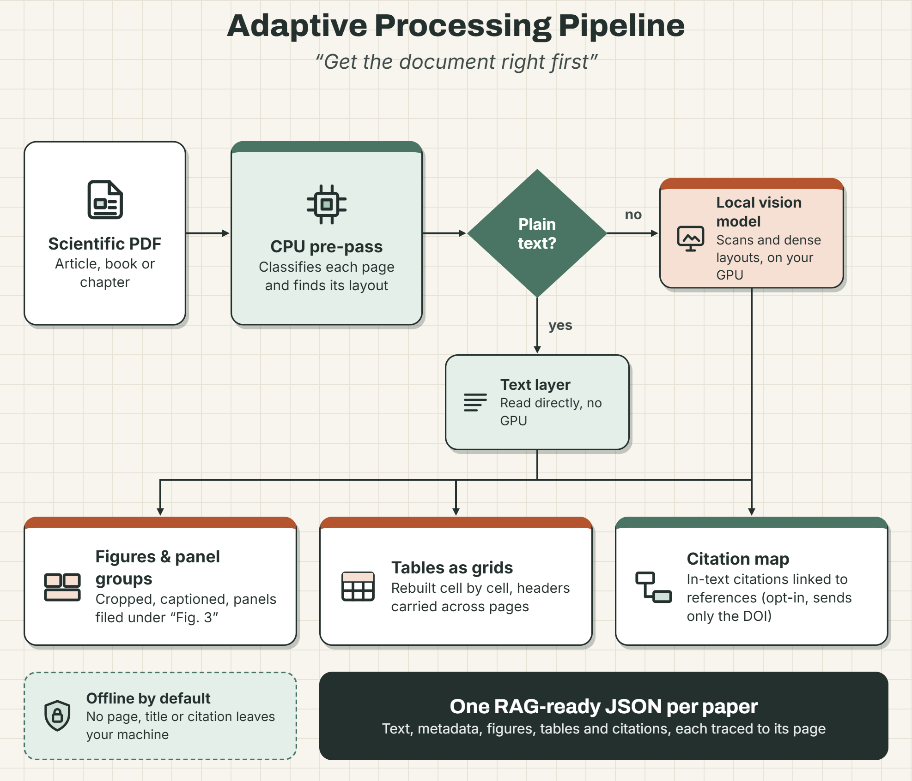
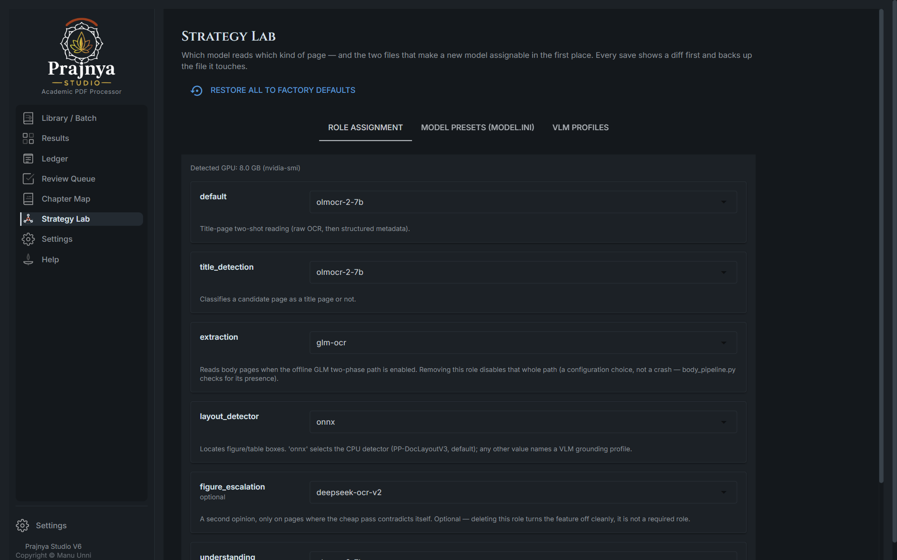

# Prajnya manual

How to install, run and configure Prajnya, and what every part of its output
means. For what Prajnya is and why, start with the [README](README.md); for how
it measures up, [BENCHMARK.md](BENCHMARK.md).

## Contents

1. [How it works](#how-it-works)
2. [Installation in detail](#installation-in-detail)
3. [The command line](#the-command-line)
4. [Prajnya Studio](#prajnya-studio)
5. [Local or cloud](#local-or-cloud)
6. [Books](#books)
7. [Metadata review](#metadata-review)
8. [Citations and links](#citations-and-links)
9. [What you get](#what-you-get)
10. [Performance](#performance)
11. [Configuration](#configuration)
12. [Troubleshooting](#troubleshooting)
13. [Roadmap](#roadmap)

---

## How it works

On a single GPU, processing time is essentially the total amount of model work,
so the most effective way to be fast is to **not call a vision model where it is
not needed**.

<p align="center">
  
</p>

1. **Classify.** Each document is sorted as a research article, a book or a book
   chapter. Before any model runs, every page is classed as plain text, a simple
   layout or a complex layout, the title page is located, and a page with no
   text layer is treated as a scan.
2. **Route.** Plain prose comes straight from the PDF's text layer with no model
   call. Figures and tables are found by a small layout model on the CPU, cropped
   and handled as objects. Only scans and dense layouts are read by a vision
   model, one page at a time.
3. **Check.** Where the cheap pass contradicts itself (a figure the layout model
   saw but the page read lost), a second model reads that page, and only that
   page.
4. **Link.** The page text is searched for figure and table mentions and, at the
   `online` level, for citations; each is linked to its object or reference.
5. **Write.** One JSON per document, against a published schema, with every
   crop beside it.

**Figures and tables are retrievable objects.** Each is cropped, given a stable
identity, and carries its caption and page. Panels of one figure are grouped
under the printed label a reader would cite ("Fig. 3"), and every table also
carries a rebuilt grid.

**Metadata is verified, not believed.** A model's reading of the title page,
the raw text layer, and an authority (Zotero, Crossref) are reconciled, and the
result records where each value came from and how well the sources agreed.

**Model-agnostic.** No model name appears in the code. Jobs ("roles") are bound
to models in configuration; see [Configuration](#configuration).

---

## Installation in detail

| | |
|---|---|
| **OS** | Windows 10/11 or Linux. |
| **Python** | **3.10**. Both entrypoints refuse to start on anything else. |
| **RAM** | **16 GB** minimum. Prajnya with its model server uses up to about 9 GB. |
| **VRAM** *(local mode only)* | **8 GB** (NVIDIA). With the shipped model presets, use peaks at about 7.9 GB (olmocr-2-7b on the title page) and about 3.4 GB for the rest of the document (glm-ocr). Other models use different amounts. |
| **[llama.cpp](https://github.com/ggml-org/llama.cpp)** *(local mode only)* | `llama-server`, built with your GPU backend. Not bundled. |
| **Disk** | **~13 GB** of model weights for local mode, plus your output. In cloud mode, only the 131 MB layout model. |

**1. Code and environment.**

```bash
git clone https://github.com/mku1988-oss/Prajnya-Academic-PDF-Processor.git
cd Prajnya-Academic-PDF-Processor
conda create -n prajnya python=3.10
conda activate prajnya
pip install -r requirements.txt
```

Keep this environment **activated** for every command. Another Python on your
PATH may have the same packages at different versions and would run without
complaint while producing different numbers; both entrypoints check the
interpreter first and stop with an explanation if it is the wrong one.

**2. Models.** Weights are not in the repository.
[`models/README.md`](models/README.md) lists every file, its licence and where
to put it: one download for the 131 MB layout model, and three `model`/`mmproj`
GGUF pairs (12.7 GB) into `models/<vendor>/`.

**3. The model server.** Tell the launcher where `llama-server` is, once:

```bash
# in .env, or your environment
PRAJNYA_LLAMA_SERVER=/path/to/llama.cpp/build/bin/llama-server
```

**4. Check:** `python run_llama_server.py --check` resolves every model path in
`config/vlm_profiles/model.ini` and names anything missing.

**Optional: Zotero.** Put `ZOTERO_API_KEY` and `ZOTERO_LIBRARY_ID` in `.env` to
cross-check metadata against your library. Without them the run says so plainly
and continues.

**A GPU is not mandatory.** Prajnya also runs against a cloud vision model (see
[Local or cloud](#local-or-cloud)). A CPU-only machine with no cloud key still
runs the folder scan, the ledger, the review queue and every screen of the
interface.

**Optional: run the tests.** `python -m pytest tests -q -rs` runs the
self-contained tests. They need no model, no GPU and no sample PDFs; the few
that would need one skip and say why. The same tests run on every push
(`.github/workflows/tests.yml`, Windows). The checks that need the models and
a sample corpus are run before each release on the maintainer's machine.

---

## The command line

Start the model server first, and leave it running:

```bash
python run_llama_server.py
```

Use the launcher, not `llama-server` by hand. It starts the server from the
right directory (the model paths in the configuration are relative to it) with
`--models-max 1`, so only one model occupies the GPU at a time. A model left
loaded by a previous document would push the next one out of video memory and
make it about three times slower, with identical output.

```bash
run_prajnya.py --pdf <file|folder> [options]
run_prajnya.py --review
run_prajnya.py --recite [--citations LEVEL]
```

| flag | what it does |
|---|---|
| `--pdf PATH` | a PDF, **or a folder** of PDFs. Required unless `--review` or `--recite`. |
| `--recursive` | with a folder, search subdirectories too |
| `--pages "2-5"` | only these 1-based pages. Accepts `4`, `2-5`, `1 3-5`, `2-5,7` |
| `--force` | re-process even if the ledger already has this document |
| `--review` | review flagged metadata and stop. **No PDF is read, no model is called.** |
| `--chapters [N …]` | books: read these chapters (`3-5` ranges work); with no numbers, read **every** chapter |
| `--max-pages N` | books: hard ceiling on body pages read |
| `--out PATH` | where results go (default `run_outputs/` in this repository) |
| `--noninteractive` | never prompt. Books take the cheap default; review is deferred to `--review` |
| `--citations LEVEL` | `local`, `zotero` or `online` for this run (see [Citations and links](#citations-and-links)); otherwise the configured level |
| `--recite` | re-derive the citation record of documents **already processed**, at the current level, and stop. **No page is read again, no model is called.** |
| `--front-matter-pages N` | leading pages scanned for DOI / ISBN / ISSN (default 10) |
| `--backend NAME` | PDF backend, `pypdfium2` (default) or `pymupdf` |
| `--verbose` | debug logging |

Exit codes: `0` everything processed; `1` nothing could run; `2` finished, but
at least one document failed. **A batch never stops for one bad PDF.**

```bash
run_prajnya.py --pdf "paper.pdf"                              # one paper
run_prajnya.py --pdf "paper.pdf" --pages 1 4-7                # some pages
run_prajnya.py --pdf "C:/papers" --recursive --noninteractive # a folder, unattended
run_prajnya.py --pdf "C:/papers" --force --out "C:/rerun"     # redo, ignoring the ledger
run_prajnya.py --pdf "volume.pdf" --chapters 3-5              # chapters of a book
run_prajnya.py --review                                       # fix incomplete metadata later
run_prajnya.py --pdf "paper.pdf" --citations online           # with its reference list and linked citations
run_prajnya.py --recite --citations online                    # add them to everything already processed
```

---

## Prajnya Studio

`python run_prajnya_studio.py` opens the interface in your browser at
`http://127.0.0.1:8850` (`--port` to change it, `--no-browser` to not open a
tab). Scanning a folder works with no model server running; **processing pages
needs `llama-server`**, as for the command line. Each document runs in its own
process, so **Stop** really stops the document in progress, and a long batch
cannot freeze the interface.

| screen | shortcut | what it is for |
|---|---|---|
| **Library / Batch** | `Ctrl+L` | Choose a folder, **Scan** to classify every PDF on the CPU (~1 s each, no GPU), then **Start**. Live log, a real **Stop**, and books asked about in a dialog. |
| **Results** | | One document at a time: see below. |
| **Ledger** | `Ctrl+G` | Every document ever processed, searchable. Per-row edit, CSV and BibTeX export. |
| **Review Queue** | | Whatever is flagged incomplete, with exactly which fields are missing. |
| **Chapter Map** | | Books only: every chapter's authors and start page, and a per-chapter **Read** button. |
| **Strategy Lab** | `Ctrl+K` | Which model does which job. Shows a diff before every save, backs up what it touches, and warns before you assign two models your card cannot hold together. |
| **Settings** | `Ctrl+,` | Output and ledger locations, book policy, PDF backend, light/dark theme. |
| **Help** | | Quick start and FAQ. |

**Results** shows, for the chosen document:

- the verified metadata, how it was validated, and how many figure mentions,
  table mentions and citations were linked;
- the page text, one page at a time, with **Links on this page**: every mention
  and citation that starts on it, and what it points to;
- the **figure gallery**, grouped by printed label, each figure with its caption
  and **Mentioned in the text**: every sentence that cites it, with its page;
- every **table**, its crop beside its rebuilt grid, and the sentences citing it;
- the **reference list** (at the `online` level), each entry with its DOI and the
  sentences that cite it;
- the raw JSON.

<p align="center">
  
</p>
<p align="center"><em>Strategy Lab: each job bound to a model, swappable without touching code.</em></p>

---

## Local or cloud

A **job can be bound to a cloud vision model instead of a local one**, and the
pipeline switches to its cloud path automatically:

```yaml
# config/research_article_strategy.yaml
profile_registry:
  default: "gemini-3-flash"
```

```bash
# .env
GEMINI_API_KEY=your-key-here
```

No code is touched. The shipped cloud profiles (`gemini-2-5-flash`,
`gemini-2-5-pro`, `gemini-3-flash`, `gemini-3-pro`) carry their API parameters,
image sizing and rate limits.

| | fully local | cloud |
|---|---|---|
| hardware | an 8 GB GPU | any machine, including CPU-only |
| privacy | nothing leaves the machine | pages are sent to the provider |
| cost | electricity | per page, at the provider's rate |
| setup | download the weights, run the server | one API key |

The cloud path still reads the free text layer wherever a page is plainly text,
so you pay only for pages that need a model. Binding is per job, so a cloud
model can read title pages while a local model reads the body.

> The default configuration is **entirely local**. No cloud profile is active
> unless you assign one.

---

## Books

The difference between a paper and a 345-page volume is minutes versus hours of
GPU, so Prajnya never guesses:

- **A folder is pre-flighted first.** Every PDF is classified on the CPU and the
  list is shown, books included, **before any GPU work starts.**
- **The default is the cheap one.** Without `--chapters`, a book gives its front
  matter and chapter map (title, editors, publisher, identifiers, and every
  chapter with its own authors and start page) in seconds, with no GPU.
- **`--noninteractive` always resolves cheap**, so an unattended batch never
  starts an accidental two-hour read.

Per-chapter authorship is the point: in an edited volume a passage retrieved
from chapter 3 must cite *that chapter's* authors, not the editors.

`config/processing_policy.yaml` holds the book policy for both the command line
and the interface:

```yaml
books:
  policy: ask         # skip | ask | all | chapters
  chapters: []        # used only when policy is `chapters`
  max_pages: null     # ceiling on body pages, whatever the policy
```

---

## Metadata review

Every processed document is assessed, written to the ledger, and flagged if
something a citation needs is missing. What is required depends on the type:

| type | must have |
|---|---|
| `research_article` | title + authors + DOI + journal |
| `book` | title + (editors \| authors) + (publisher \| ISBN) + year |
| `book_chapter` | title + authors + (journal \| publisher) + DOI |

A record is also flagged when the sources disagree too much, or the author list
looks unreliable. For one document you are asked straight away; a batch asks
once at the end; `--noninteractive` defers everything to
`run_prajnya.py --review` (or the Review Queue screen). Corrections go into the
ledger and back into the document's output JSON.

The **ledger** (`persistence/semantic_ledger.csv` by default, or
`PRAJNYA_LEDGER_PATH`) is keyed by each file's SHA-256, so renaming a PDF does not
create a duplicate and an interrupted batch loses nothing.

---

## Citations and links

A paper's text points at three kinds of thing: its figures, its tables, and
other papers. Prajnya links all three.

### Figure and table mentions: every level, offline

Every "Fig. 3B", "Figures 2 and 4" or "Table 2" in the page text is found and
linked to the figure or table object carrying that printed label. Nothing leaves
the machine. Each mention records its page, where it stands in that page's text
(`content_offset`), what was printed, and the object(s) it points to. A mention
naming two figures gives two records; panels of one figure ("Fig. 1A and 1D")
give one.

Mentions that are deliberately **not** linked are counted instead:
supplementary items ("Figure S1", "Extended Data Fig. 2", "S1 Fig") are not
printed in the article, and a legend's own label ("Figure 3." starting Figure
3's caption) is not a mention. A mention whose object was not found keeps an
empty target list: the mention is real, the object is missing.

### Citations: three levels, one setting per run

| level | how the document is cited | reference list and linked citations | what leaves your machine |
|---|---|---|---|
| `local` *(default)* | Prajnya's own reading: text-layer DOI and title page | no | **nothing** |
| `zotero` | checked against your Zotero library | no | title queries to Zotero |
| `online` | Crossref, by DOI or by title under a strict acceptance rule; OpenAlex as fallback | **yes** | the DOI or the title, to Crossref and OpenAlex. **Never page content.** |

Set it in `config/research_article_strategy.yaml` (`citations.level`), or for one
run with `--citations`. Every document records the level it was cited at.
`--recite` brings documents already processed up to the current level in
seconds, without reading their pages again or calling a model.

### What `online` adds

- **The reference list**, in printed order: the publisher's deposited list
  (Crossref), gaps filled from OpenAlex, **checked against the list printed in
  the PDF itself**. Each entry carries its position, printed number, first
  author, year, title, journal, DOI and the text as printed. Whether the two
  readings agree on the length of the list is recorded (`counts_agree`).
- **The in-text citations.** Each becomes a marker that names the entries it
  cites and says where it stands in the page text (`content_offset`), so a
  citation glued to a word ("stability²⁴⁵") is still known to be one. Both
  styles are read:
  - **numbered**: brackets `[3–7]`, parentheses `(12, 14)`, superscripts;
  - **author–year**: `(Doi et al., 2005; Smith and Jones, 1999a)`,
    `Berendsen (1962)`, `Bella et al., 1994, 1995`, a citation broken across a
    line or a page.

### A wrong link is worse than none

A missing link costs a reader a lookup. A wrong one sends them to the wrong
paper. So every rule prefers to say nothing:

- A **numbered** citation links only where a list entry's printed number equals
  its place in the list. Numbers beyond the list, affiliation marks on author
  lines (`Lambert¹,¹³`) and lane numbers in figure legends are not citations.
- An **author–year** citation links only when **exactly one** entry has that
  surname and year. A second author or "et al." may narrow the candidates; a
  year with a letter (`2001a`) needs that letter printed in the entry. Two
  candidates ("Holmes et al., 2001", printed twice without letters), or none:
  no link.

---

## What you get

```
run_outputs/
├── documents/<name>.v6.json      one per document
├── batch_summary.json            the latest batch
├── figures/<document>/           p3_fig1.png … + manifest.json
└── tables/<document>/            table crops + manifest.json
```

Results go to `run_outputs/` in this repository whatever directory you launch
from (`--out` overrides it). Every path inside is relative to the run root, so
the whole tree can be moved and every crop still resolves. A real example
(only the PDF's local path replaced) is in
[`contract/examples/frontiers_acidovorax_hrp/`](contract/examples/frontiers_acidovorax_hrp/).

### The document JSON

```jsonc
{
  "document_info":  { "filename", "document_type", "processing_time", "success",
                      "pipeline_version", "contract_version" },
  "metadata_final": { "title", "authors", "doi", "journal", "year", "editors", … },
  "review_status":  "reviewed | provisional",
  "pages": [ { "page_number",
               "content",          // the page text as read
               "body",             // the running text: content without furniture and outside_body
               "quality_score",    // a rough guess, not a measured accuracy
               "metadata": { "processing_method", "page_type",
                             "figures", "tables",
                             "headings",             // typography of candidate heading lines
                             "furniture",            // running heads, page numbers: kind, start, end, text
                             "outside_body",         // placeholders, tables, legends, the reference list
                             "reference_density",    // how bibliographic the page reads, 0-1
                             "has_reference_heading",
                             "chapter": { "number", "title", "authors" } } } ],
  "mentions": { "figures": [ { "page_number", "content_offset", "text", "number", "targets" } ],
                "tables":  [ … ],
                "skipped": { "supplementary", "own_label" } },
  "citations": { "level", "source_label",               // how to cite this document
                 "reference_list": { "status", "source", "style", "count", "counts_agree" },
                 "references": [ { "position", "number", "first_author", "year",
                                   "title", "container", "doi", "printed_text" } ],
                 "markers":    [ { "page_number", "text", "kind",
                                   "numbers",           // positions in `references`
                                   "context_before", "content_offset" } ] },
  "summary": { "errors", "page_count", "figure_count" }
}
```

The shape is a published contract,
[`contract/prajnya_document.schema.json`](contract/prajnya_document.schema.json)
(version 1.3). **Every offset in the file indexes the page's `content`**, never
`body`; `body` is for splitting text into passages.

`processing_method` says how each page was actually read: `pymupdf` (the text
layer, no GPU; the name is historical, the text layer is read with pypdfium2),
`glm_fullpage` (a vision-model read), `glm_repair` (a page read whose dropped
table was restored from the table's own crop), `two_shot_title_page`,
`gemini_single_pass` (a cloud read). `glm_failed` and `two_shot_title_failed`
mean the read failed; `metadata.error` then says why. `page_type` is what the
classifier predicted before reading (`text_only`, `simple_visual`,
`complex_visual`); where the two disagree, `processing_method` is the truth.

For a retrieval layer: **`headings`** gives each line that looks like a heading
with its size, weight and capitalisation relative to the body text, the only
evidence of depth an unnumbered heading has. **`furniture`** and
**`outside_body`** mark what is not running text, so a passage never starts with
a running head or swallows a legend. **`reference_density`** and
**`has_reference_heading`** say how much a page reads like a bibliography, which
is full of search terms while stating nothing.

### Figures

Every document's figure directory has a `manifest.json`:

```jsonc
{
  "figure_id": "p10_fig1",                             // stable within the document
  "image_path": "figures/PMC5880930/p10_fig1.png",     // relative to the run root
  "caption":  "FIGURE 8 | <the printed caption>",
  "page": 10,
  "bbox": [484, 299, 2047, 980],                       // pixels at the detection DPI
  "printed_label": "FIGURE 8",                         // what a reader would cite
  "label_key": "figure 8",                             // panels of one figure share it
  "panel_group_size": 1                                // >1 for one panel of several
}
```

Figures are deliberately not described by a model at extraction time: the crop,
its caption and the sentences that mention it are enough to retrieve it, and
interpreting the image belongs to a multimodal model at question time.

### Tables

A table is extracted twice over, as an image and as a rebuilt grid:

```jsonc
{
  "table_id": "p3_tab1",
  "image_path": "tables/PMC5880930/p3_tab1.png",
  "caption": "TABLE 1 | Bacterial strains and plasmids used in this study.",
  "page": 3,
  "bbox": [183, 270, 2527, 2129],
  "grid": "<table>…</table>"
}
```

Every table crop is read to produce its grid. Where a page read silently dropped
a table, the table's reading is also restored into the page text. A table
continued onto the next page keeps its column headers.

---

## Performance

What a page costs depends on what is on it. Measured on a 9-document sample
corpus (485 pages) with v6.2.0 on one 8 GB GPU:

| kind of page | pages | median s/page | total |
|---|---:|---:|---:|
| title page | 8 | 53.1 | 408 s |
| text layer, no GPU | 290 | **0.1** | 41 s |
| model read (figures, no table) | 146 | 12.8 | 1928 s |
| page with a table | 25 | 25.6 | 699 s |
| scanned page, no text layer | 6 | 30.3 | 232 s |

Each document also pays a fixed cost of roughly 35–110 s: loading the models,
looking up its metadata, and checking its figures once every page is read. With
the title page, that is why a short paper costs more per page than a long one.
61.9% of pages never reached the GPU.

On the benchmark's 40 papers (761 pages, v6.7.0), Prajnya took 11.1 s per page
and a median of 175 s per paper; the `online` level added about 5 s per paper.
See [BENCHMARK.md](BENCHMARK.md#cost-reported-not-ranked).

---

## Configuration

Everything model-specific lives in `config/`.

| role (job) | what it does | shipped default |
|---|---|---|
| `default` | general reading | `olmocr-2-7b` |
| `title_detection` | the title-page reading | `olmocr-2-7b` |
| `extraction` | body pages and tables | `glm-ocr` |
| `layout_detector` | finds figures and tables | `onnx` (CPU) |
| `figure_escalation` | second opinion where the fast pass contradicts itself | `deepseek-ocr-v2` |
| `understanding` | reserved; unused today | `olmocr-2-7b` |

| file | holds |
|---|---|
| `config/research_article_strategy.yaml` | which model plays each role, and the pipeline's settings |
| `config/vlm_profiles/<model>.yaml` | each model's prompts, image size and memory needs |
| `config/vlm_profiles/model.ini` | the model server's settings: weight files, context size, sampling |

The three must agree. **Strategy Lab** edits them with a diff before every save,
checks them against each other, and can duplicate a profile so you can try a new
model without editing Python. `config/factory_defaults/` holds the shipped
configuration; every **Restore Defaults** button reads from it.

| environment variable | effect |
|---|---|
| `PRAJNYA_LLAMA_SERVER` | where the `llama-server` binary is |
| `PRAJNYA_LEDGER_PATH` | keep the ledger elsewhere |
| `PRAJNYA_CACHE_PATH` | move the Zotero cache |
| `PRAJNYA_CITATION_CACHE_PATH` | move the Crossref / OpenAlex answer cache |
| `PRAJNYA_GUI_STORAGE_SECRET` | keep interface sessions across a restart |
| `ZOTERO_API_KEY`, `ZOTERO_LIBRARY_ID` | enable Zotero enrichment |

All are read from `.env` if present.

Releases up to 6.7.0 named them `SARA_*`; those names still work, and a warning names the one to use. <!-- release-rename: keep -->

---

## Troubleshooting

| symptom | cause and fix |
|---|---|
| **"the wrong Python is running this file"** | The project environment is not active. `conda activate prajnya` and re-run; the message names the interpreter it got. If the environment cannot be found by name, `conda env list` shows its path, and running its `python` directly always works. |
| **A run fails part way with a model error** | `llama-server` was started by hand from another directory, so the model paths resolve to nothing. Start it with `python run_llama_server.py`. |
| **Everything is ~3× slower than usual, with identical output** | A model from an earlier run is still in video memory. Restart the server with `python run_llama_server.py` (it uses `--models-max 1`). |
| **"Port 8850 is already in use"** | Prajnya Studio is probably open in another window. Otherwise use `--port 8851`. |
| **The interface loads but processing fails at once** | `llama-server` is not running. Scanning needs no server; reading pages does. |
| **A document is processed again although it ran before** | The ledger is keyed by the file's contents, so an edited PDF is a new document. `--force` re-processes either way. |
| **Zotero metadata is not used** | `ZOTERO_API_KEY` / `ZOTERO_LIBRARY_ID` are not set; the log says so at startup. |
| **A book "finished" in seconds** | That is the default: front matter and chapter map only. Add `--chapters` to read the body. |
| **No reference list or citation links** | They are made at the `online` level only. Re-run with `--citations online`, or bring finished documents up with `--recite --citations online`. |

To confirm a run stayed offline, the log should mention `localhost` for every
model call and no external service apart from Zotero, if you enabled it.

---

## Roadmap

- **Multimodal RAG, "search by chart".** Built in the layer above
  (Shastrasaara), not here: Prajnya's job is to produce retrievable, linked
  objects, and its output format is shaped to make that layer easy to write.
- **Crop quality.** A crop can still include part of its caption or miss a panel
  that sits apart from the rest; the next benchmark version scores crops.
- **Author–year citations** in some recent layouts are not yet read when the
  printed reference list is not found.
- **Books** are so far measured against one publisher's layout conventions.
