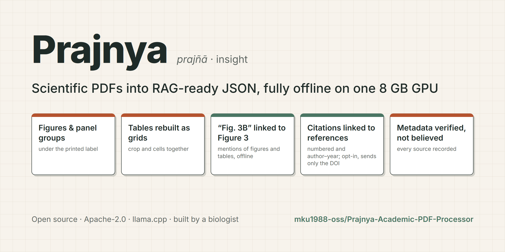
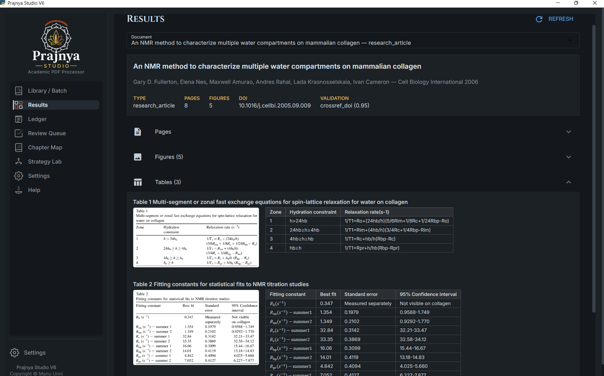
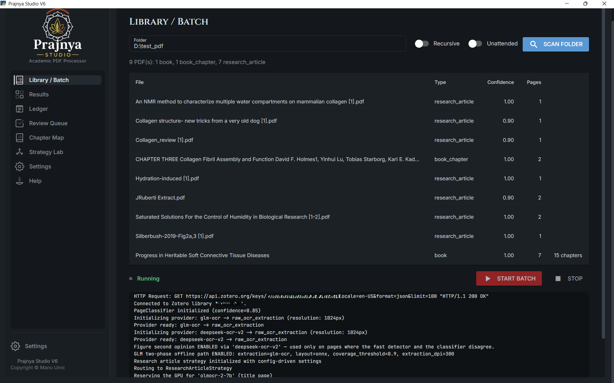
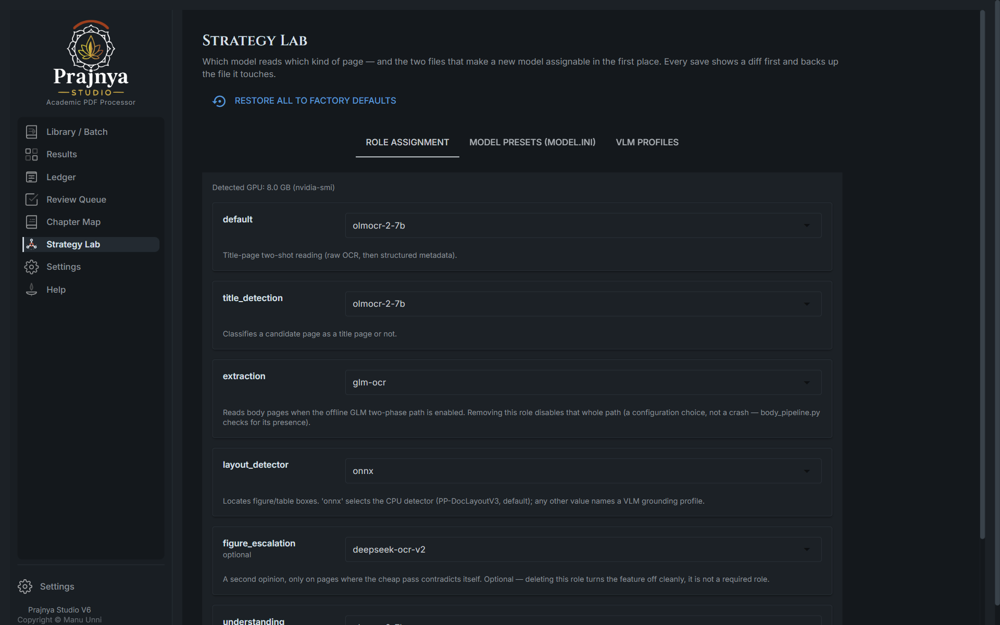

# Prajnya

### Scientific PDF Processing Engine for RAG

   

<p align="center">
  
</p>

**Prajnya turns scientific PDFs into RAG-ready JSON: text, verified metadata,
figures with their panels grouped, tables rebuilt as grids, and citations linked
to the reference list, each traced to the page it came from. It runs fully
offline on a single 8 GB GPU.**

*prajñā* (Sanskrit): insight, wisdom. Built by a biologist, for researchers.

> **«In RAG, what goes in determines what comes out.»**

Scientific PDFs are not simply collections of text. What matters is spread
across metadata, figures, tables, captions, scanned pages and complex layouts,
and a poor representation of the document leads to poor retrieval and
unreliable reasoning downstream. Prajnya treats the document layer as a core
part of the system, not a preprocessing afterthought: **get the document right
first.**

## Current capabilities

- **Document and page classification on the CPU.** Papers, books and book
  chapters each get their own pipeline, and every page is sorted before any
  model runs.
- **Plain prose straight from the text layer**, with no model call. Only scans
  and dense layouts are read by a vision model.
- **Metadata verified, not believed.** The title page, the text layer and an
  optional authority are reconciled, and the source of every value is recorded.
- **Figures as objects**: cropped, captioned, with multi-panel figures grouped
  under the label a reader would cite ("Fig. 3").
- **Tables as objects**: cropped and rebuilt as grids. A table continued onto
  the next page keeps its column headers.
- **Reference lists, with every in-text citation linked to the entry it
  names**, numbered (`[12]`, `(3–7)`, superscripts) and author–year
  (`(Doi et al., 2005)`, `Berendsen (1962)`). This is the opt-in `online`
  citation level, which sends only a DOI or title, never page content. See
  [Citations](#citations).
- **Books**, with a chapter map of each chapter's authors and start page.
- **One model on the GPU at a time**, so an 8 GB card is enough. Or no GPU at
  all, with a cloud model.
- **Provenance on everything**: each page records how it was read, against a
  published JSON schema.

**Fully offline by default.** Unpublished, embargoed and licensed papers often
cannot be uploaded to a third party. In the shipped configuration no page, no
title and no citation leaves your machine. A role can be pointed at a cloud
model instead (see [Local or cloud](#local-or-cloud)), but that is a choice you
make, never a default.

Prajnya is the ingestion layer of **Shastrasaara**, a local, multimodal
scientific RAG system in development.

What changed in each release is in [`CHANGELOG.md`](CHANGELOG.md).

---

## Contents

- [How it works](#how-it-works) · [Is Prajnya right for you?](#is-prajnya-right-for-you) · [Requirements](#requirements) · [Installation](#installation) · [Quick start](#quick-start)
- [Prajnya Studio](#prajnya-studio) · [The command line](#the-command-line) · [Local or cloud](#local-or-cloud)
- [Books](#books) · [Metadata review](#metadata-review) · [Citations](#citations)
- [What you get](#what-you-get) · [Performance](#performance) · [Configuration](#configuration)
- [Troubleshooting](#troubleshooting) · [Roadmap](#roadmap) · [Citation](#citation) · [Licence](#licence)

---

## How it works

On a single GPU, processing time is essentially the total amount of model work,
so the most effective way to be fast is to **not call a vision model where it is
not needed**.

```
        ┌──────────── CPU PRE-PASS (all pages, ~1s total) ─────────────┐
 PDF ──►│ text harvest │ page classification │ layout detection (ONNX) │
        └──────────────┬────────────────────────────────────────────────┘
                       ▼
      a plan for each page: read the text layer | read crops | read the page
```

A cheap CPU pass reads the text layer, classifies each page and detects its
layout, then decides the **minimum** set of vision-model calls. Plain prose
comes straight from the text layer; figures and tables are cropped and handled
as objects; only pages that genuinely need vision (scans, dense layouts) are
read by the model. That is why a book, mostly prose, costs less per page than a
dense paper.

**Figures and tables leave as retrievable objects.** Each is cropped, given a
stable identity, and carries its caption and page. Panels of one figure are
grouped under the printed label a reader would cite ("Fig. 3"), and every table
also carries a reconstructed grid, so its numbers can be searched while the
image stays available to a multimodal model.

**Metadata is verified, not believed.** A model's reading of the title page, the
raw text layer, and an authority (Zotero, by DOI) are reconciled, and the result
records where each value came from and how well the sources agreed.

**Model-agnostic.** No model name appears in the code. Roles (`extraction`,
`layout_detector`, `title_detection`, …) are bound to models in configuration,
so swapping a model, or moving a role to a cloud model, is a configuration
change.

---

## Is Prajnya right for you?

**Use it if** you need scientific PDFs (papers, books, chapters) turned into
structured data you own: for a RAG system, a literature database or your own
scripts, and especially if the documents cannot leave your machine.

**It does not (yet):**

- chat with your papers, chunk, embed or retrieve. It is the ingestion layer;
  retrieval is Shastrasaara's job.
- read anything but PDFs. No DOCX, HTML or slides.
- install in one click. Local mode needs `llama-server` and about 13 GB of
  model weights.

---

## Requirements

| | |
|---|---|
| **OS** | Windows 10/11 or Linux. |
| **Python** | **3.10**. Both entrypoints refuse to start on anything else. |
| **GPU** *(local mode only)* | An **8 GB** NVIDIA card is enough, and is what every number here was measured on. Not needed at all in cloud mode. |
| **[llama.cpp](https://github.com/ggml-org/llama.cpp)** *(local mode only)* | `llama-server`, built with your GPU backend. Not bundled; it is a separate project. |
| **Disk** | **~13 GB** of model weights for local mode, plus your output. In cloud mode, only the 131 MB layout model. |

**A GPU is not mandatory.** Prajnya also runs against a cloud vision model, in
which case no local GPU is used at all. A CPU-only machine with no cloud key
still runs the pre-flight scan, the ledger, the review queue and every screen
of the interface.

---

## Installation

> **A note on names.** **Prajnya** is this engine, and **Prajnya Studio** is its
> graphical interface. **Shastrasaara** is the larger scientific RAG system the
> engine is built to feed. The project began as Shastrasaara, which is why the
> name still appears in the source tree, in the `SARA_*` environment variables,
> and as the conda environment name below.

**1. Get the code and the Python environment.**

```bash
git clone https://github.com/mku1988-oss/Prajnya-Academic-PDF-Processor.git
cd Prajnya-Academic-PDF-Processor

conda create -n shastrasaara python=3.10
conda activate shastrasaara
pip install -r requirements.txt
```

Keep this environment **activated** for every command below. Another Python on
your PATH may have the same packages at different versions, and would run
without complaint while quietly producing different numbers; both entrypoints
check the interpreter first and stop with an explanation if it is the wrong one.

**2. Download the models.** Weights are not in the repository.
[`models/README.md`](models/README.md) lists every file, its licence, and where
to put it: one `curl` for the 131 MB layout model, and three `model`/`mmproj`
GGUF pairs (12.7 GB) into `models/<vendor>/`.

| model | role | licence |
|---|---|---|
| PP-DocLayoutV3 (ONNX) | layout detection, on the CPU | Apache-2.0 |
| GLM-OCR | page reading and tables | MIT / Apache-2.0 |
| olmOCR-2-7B | title pages, scanned fallback | Apache-2.0 |
| DeepSeek-OCR-2 | figure second opinion | Apache-2.0 |

**3. Tell the launcher where `llama-server` is**, once:

```bash
# in .env, or your environment
SARA_LLAMA_SERVER=/path/to/llama.cpp/build/bin/llama-server
```

**4. Check the install:**

```bash
python run_llama_server.py --check
```

It resolves every model path in `config/vlm_profiles/model.ini` and names
anything missing.

**Optional: Zotero enrichment.** Put `ZOTERO_API_KEY` and `ZOTERO_LIBRARY_ID`
in `.env` to cross-check metadata against your library. Without them the run
says so plainly and continues.

---

## Quick start

```bash
# 0. Activate the environment (every command below assumes it)
conda activate shastrasaara

# 1. Start the model server and leave it running
python run_llama_server.py

# 2a. Process a paper from the command line
python -u run_prajnya.py --pdf "paper.pdf"

# 2b. ...or open the graphical interface instead
python -u run_prajnya_studio.py
```

**Start the server with `run_llama_server.py`, not by running `llama-server`
yourself.** The launcher starts it from the right directory (the model paths in
the configuration are relative to it), with `--models-max 1` so only one model
occupies the GPU at a time. A model left loaded by a previous document would
otherwise push the next one out of video memory and make it about three times
slower, with identical output.

---

## Prajnya Studio

`run_prajnya_studio.py` opens the graphical interface in your browser, at
`http://127.0.0.1:8850` (`--port` to change it, `--no-browser` to not open a
tab). The default is 8850, clear of the model server's port (9931).

<p align="center">
  
</p>
<p align="center"><em>Results: every table's crop beside its reconstructed grid.</em></p>

<p align="center">
  
  
</p>
<p align="center"><em>Left: verified metadata and page text. Right: a folder classified on the CPU, before any model runs.</em></p>

<p align="center">
  
</p>
<p align="center"><em>Strategy Lab: each role bound to a model, swappable without touching code.</em></p>

| screen | shortcut | what it is for |
|---|---|---|
| **Library / Batch** | `Ctrl+L` | Choose a folder, **Scan** to classify every PDF on the CPU (~1s each, no GPU), then **Start**. Live log, a real **Stop**, and books asked about in a dialog. |
| **Results** | | Metadata, page text, the figure gallery grouped by printed label, tables beside their reconstructed grids, and the raw JSON. |
| **Ledger** | `Ctrl+G` | Every document ever processed, searchable. Per-row edit, CSV and BibTeX export. |
| **Review Queue** | | Whatever is flagged incomplete, with exactly which fields are missing. |
| **Chapter Map** | | Books only: every chapter's authors and start page, and a per-chapter **Read** button. |
| **Strategy Lab** | `Ctrl+K` | Which model does which job. Shows a diff before every save, backs up what it touches, and warns before you assign two models your card cannot hold together. |
| **Settings** | `Ctrl+,` | Output and ledger locations, book policy, PDF backend, light/dark theme. |
| **Help** | | Quick start and FAQ. |

Scanning a folder works with no model server running; **processing pages
needs `llama-server`**, as for the command line. Each document runs in its own
process, so **Stop** really stops the document in progress, and a long batch
cannot freeze the interface.

---

## The command line

```bash
run_prajnya.py --pdf <file|folder> [options]
run_prajnya.py --review
```

| flag | what it does |
|---|---|
| `--pdf PATH` | a PDF, **or a folder** of PDFs. Required unless `--review`. |
| `--recursive` | with a folder, search subdirectories too |
| `--pages "2-5"` | only these 1-based pages. Accepts `4`, `2-5`, `1 3-5`, `2-5,7` |
| `--force` | re-process even if the ledger already has this document |
| `--review` | review flagged metadata and stop. **No PDF is read, no model is called.** |
| `--chapters [N …]` | books: read these chapters (`3-5` ranges work); with no numbers, read **every** chapter |
| `--max-pages N` | books: hard ceiling on body pages read |
| `--out PATH` | where results go (default `run_outputs/` in this repository) |
| `--noninteractive` | never prompt. Books take the cheap default; review is deferred to `--review` |
| `--citations LEVEL` | `local`, `zotero` or `online` for this run (see [Citations](#citations)); otherwise the configured level |
| `--recite` | re-derive the citation record of documents **already processed**, at the current level, and stop. **No PDF page is read again, no model is called.** |
| `--front-matter-pages N` | leading pages scanned for DOI / ISBN / ISSN (default 10) |
| `--backend NAME` | PDF backend, `pypdfium2` (default) or `pymupdf` |
| `--verbose` | debug logging |

Exit codes: `0` everything processed; `1` nothing could run; `2` finished, but
at least one document failed. **A batch never stops for one bad PDF.**

```bash
run_prajnya.py --pdf "paper.pdf"                              # one paper
run_prajnya.py --pdf "paper.pdf" --pages 1 4-7                # some pages
run_prajnya.py --pdf "C:/papers" --recursive --noninteractive # a folder, unattended
run_prajnya.py --pdf "C:/papers" --force --out "C:/rerun"     # redo, ignoring the ledger
run_prajnya.py --pdf "volume.pdf" --chapters 3-5              # chapters of a book
run_prajnya.py --review                                       # fix incomplete metadata later
run_prajnya.py --pdf "paper.pdf" --citations online           # with its reference list and linked citations
run_prajnya.py --recite --citations online                    # add them to everything already processed
```

---

## Local or cloud

A **role can be bound to a cloud vision model instead of a local one**, and the
pipeline switches to its cloud path automatically:

```yaml
# config/research_article_strategy.yaml
profile_registry:
  default: "gemini-3-flash"
```

```bash
# .env
GEMINI_API_KEY=your-key-here
```

No code is touched. The shipped cloud profiles (`gemini-2-5-flash`,
`gemini-2-5-pro`, `gemini-3-flash`, `gemini-3-pro`) carry their API parameters,
image sizing and rate limits.

| | fully local | cloud |
|---|---|---|
| hardware | an 8 GB GPU | any machine, including CPU-only |
| privacy | nothing leaves the machine | pages are sent to the provider |
| cost | electricity | per page, at the provider's rate |
| setup | download the weights, run the server | one API key |

The cloud path still reads the free text layer wherever a page is plainly
text, so you pay only for pages that need a model. Binding is per role, so a
cloud model can read title pages while a local model reads the body.

> The default configuration is **entirely local**. No cloud profile is active
> unless you assign one.

---

## Books

The difference between a paper and a 345-page volume is minutes versus hours of
GPU, so Prajnya never guesses:

- **A folder is pre-flighted first.** Every PDF is classified on the CPU and the
  list is shown, books included, **before any GPU work starts.**
- **The default is the cheap one.** Without `--chapters`, a book gives its front
  matter and chapter map (title, editors, publisher, identifiers, and every
  chapter with its own authors and start page) in seconds, with no GPU.
- **`--noninteractive` always resolves cheap**, so an unattended batch never
  starts an accidental two-hour read.

Per-chapter authorship is the point: in an edited volume a passage retrieved
from chapter 3 must cite *that chapter's* authors, not the editors.

`config/processing_policy.yaml` holds the book policy for both the command line
and the interface:

```yaml
books:
  policy: ask         # skip | ask | all | chapters
  chapters: []        # used only when policy is `chapters`
  max_pages: null     # ceiling on body pages, whatever the policy
```

---

## Metadata review

Every processed document is assessed, written to the ledger, and flagged if
something a citation needs is missing. What is required depends on the type:

| type | must have |
|---|---|
| `research_article` | title + authors + DOI + journal |
| `book` | title + (editors \| authors) + (publisher \| ISBN) + year |
| `book_chapter` | title + authors + (journal \| publisher) + DOI |

A record is also flagged when the sources disagree too much, or the author list
looks unreliable. For one document you are asked straight away; a batch asks
once at the end; `--noninteractive` defers everything to
`run_prajnya.py --review` (or the Review Queue screen). Corrections go into the
ledger and back into the document's output JSON.

The **ledger** (`persistence/semantic_ledger.csv` by default, or
`SARA_LEDGER_PATH`) is keyed by each file's SHA-256, so renaming a PDF does not
create a duplicate and an interrupted batch loses nothing.

---

## Citations

A scientific paper rests on other papers. A sentence that ends "… was shown
previously [12]" or "… (Doi et al., 2005)" makes a claim and says whose work it
stands on. Prajnya can give each document its **reference list** and link
**every citation printed in its text** to the entry it names. A passage
retrieved later then carries its sources with it, and a downstream system can
write "Doi et al., 2005, cited in Bella, 2016 (p. 10)" instead of attributing a
reviewed finding to the review.

### Three levels, one setting per run

| level | how the document is cited | reference list and linked citations | what leaves your machine |
|---|---|---|---|
| `local` *(default)* | Prajnya's own reading: text-layer DOI and title page | no | **nothing** |
| `zotero` | checked against your Zotero library | no | title queries to Zotero |
| `online` | Crossref, by DOI or by title under a strict acceptance rule; OpenAlex as fallback | **yes** | the DOI or the title, to Crossref and OpenAlex. **Never page content.** |

Set it in `config/research_article_strategy.yaml` (`citations.level`), or for
one run with `--citations`. Every document records the level it was cited at.
`--recite` brings documents already processed up to the current level in
seconds, without reading their pages again or calling a model.

### What `online` adds

- **The reference list**, in printed order: the publisher's deposited list
  (Crossref), gaps filled from OpenAlex, **checked against the list printed in
  the PDF itself**. Each entry carries its position, printed number, first
  author, year, title, journal, DOI and the text as printed. Whether the two
  readings agree on the length of the list is recorded (`counts_agree`).
- **The in-text citations.** Each citation becomes a marker that names the
  entries it cites and says where it stands in the page text Prajnya writes
  out (`content_offset`), so a citation glued to a word ("stability²⁴⁵") is
  still known to be a citation. Both styles of science are read:
  - **numbered**: brackets `[3–7]`, parentheses `(12, 14)`, superscripts;
  - **author–year**: `(Doi et al., 2005; Smith and Jones, 1999a)`,
    `Berendsen (1962)`, `Bella et al., 1994, 1995`, a citation broken across a
    line or a page.

### A wrong link is worse than none

A missing link costs a reader a lookup. A wrong one sends them to the wrong
paper. So every rule prefers to say nothing:

- A **numbered** citation links only where a list entry's printed number equals
  its place in the list. Numbers beyond the list, affiliation marks on author
  lines (`Lambert¹,¹³`) and lane numbers in figure legends are not citations.
- An **author–year** citation links only when **exactly one** entry has that
  surname and year. A second author or "et al." may narrow the candidates; a
  year with a letter (`2001a`) needs that letter printed in the entry. Two
  candidates ("Holmes et al., 2001", printed twice without letters), or none:
  no link.

---

## What you get

```
run_outputs/
├── documents/<name>.v6.json      one per document
├── batch_summary.json            the latest batch
├── figures/<document>/           p3_fig1.png … + manifest.json
└── tables/<document>/            table crops + manifest
```

Results go to `run_outputs/` in this repository whatever directory you launch
from (`--out` overrides it). Every path inside is relative to the run root, so
the whole tree can be moved and every crop still resolves.

A real, unedited example (one open-access paper, with its figure and table
manifests) is in [`contract/examples/frontiers_hippo_hydra/`](contract/examples/frontiers_hippo_hydra/).

Each document JSON:

```jsonc
{
  "document_info":  { "filename", "document_type", "processing_time", "success",
                      "pipeline_version" },
  "metadata_final": { "title", "authors", "doi", "journal", "year", "editors", … },
  "review_status":  "reviewed | provisional",
  "pages": [ { "page_number", "content", "quality_score",
               "metadata": { "processing_method", "page_type", "coverage",
                             "figures", "tables",
                             "headings",              // typography of candidate heading lines
                             "reference_density",     // how bibliographic the page reads, 0-1
                             "has_reference_heading",
                             "chapter": { "number", "title", "authors" } } } ],
  "summary": { "errors", "page_count", "figure_count" },
  "citations": { "level", "source_label",                // how to cite this document
                 "reference_list": { "status", "source", "style", "count", "counts_agree" },
                 "references": [ { "position", "number", "first_author", "year",
                                   "title", "container", "doi", "printed_text" } ],
                 "markers":    [ { "page_number", "text", "kind",
                                   "numbers",            // positions in `references`
                                   "context_before", "content_offset" } ] }
}
```

The output's shape is a published contract,
[`contract/prajnya_document.schema.json`](contract/prajnya_document.schema.json),
with a worked example in
[`contract/examples/citations_online.json`](contract/examples/citations_online.json).

`processing_method` says how each page was read: `pymupdf` (text layer, no
GPU), `glm_fullpage` (a vision-model read), `glm_repair` (a page read whose
dropped table was restored from the table's own crop), `two_shot_title_page`.

The page fields for a retrieval layer: **`headings`** gives each line that looks
like a heading with its size, weight and capitalisation relative to the body
text, which is the only evidence of depth an unnumbered heading has.
**`reference_density`** and **`has_reference_heading`** say how much a page reads
like a bibliography, which is full of search terms while stating nothing.

### Figures

Every document's figure directory has a `manifest.json`:

```jsonc
{
  "figure_id": "p2_fig1",                              // stable within the document
  "image_path": "figures/<document>/p2_fig1.png",      // relative to the run root
  "caption":  "Figure 1. <the printed caption>",
  "page": 2,
  "bbox": [1376, 2190, 2342, 2870],                    // pixels at the detection DPI
  "printed_label": "Fig. 1",                           // what a reader would cite
  "label_key": "figure 1",                             // panels of one figure share it
  "panel_group_size": 1                                // >1 for one panel of several
}
```

On the sample corpus (9 documents, 485 pages), **97% of 111 figure crops carry
their printed label**, and 32 panel crops are grouped into 14 printed figures.
Figures are deliberately not described by a model at extraction time: the crop,
its caption and the surrounding text are enough to retrieve it, and
interpreting the image belongs to the multimodal model at question time.

### Tables

A table is extracted twice over, as an image and as a reconstructed grid:

```jsonc
{
  "table_id": "p4_tab1",
  "image_path": "tables/<document>/p4_tab1.png",
  "caption": "Table 1. <the printed caption>",
  "page": 4,
  "bbox": [1298, 303, 2384, 820],
  "grid": "<table>…</table>"
}
```

Every table crop is read to produce its grid. Where a page read silently dropped
a table, the table's reading is also restored into the page text.

---

## Performance

The sample corpus, 9 documents and 485 pages, on one 8 GB GPU (measured with
v6.2.0). What a page costs depends on what is on it:

| kind of page | pages | median s/page | total |
|---|---:|---:|---:|
| title page | 8 | 53.1 | 408s |
| text layer, no GPU | 290 | **0.1** | 41s |
| model read (figures, no table) | 146 | 12.8 | 1928s |
| page with a table | 25 | 25.6 | 699s |
| scanned page, no text layer | 6 | 30.3 | 232s |

Each document also pays a fixed cost of roughly 35–110s: loading the models,
looking up its metadata, and checking its figures once every page is read.
With the title page, that is why a short paper costs more per page than a long
one.

**61.9% of pages never reached the GPU**: they were read from the text layer.
The whole corpus took **63.7 min**.

---

## Configuration

Everything model-specific lives in `config/`.

| role | what it does | shipped default |
|---|---|---|
| `default` | general reading | `olmocr-2-7b` |
| `title_detection` | the title-page reading | `olmocr-2-7b` |
| `extraction` | body pages and tables | `glm-ocr` |
| `layout_detector` | finds figures and tables | `onnx` (CPU) |
| `figure_escalation` | second opinion where the fast pass contradicts itself | `deepseek-ocr-v2` |
| `understanding` | reserved; unused today | `olmocr-2-7b` |

| file | holds |
|---|---|
| `config/research_article_strategy.yaml` | which model plays each role, and the pipeline's settings |
| `config/vlm_profiles/<model>.yaml` | each model's prompts, image size and memory needs |
| `config/vlm_profiles/model.ini` | the model server's settings: weight files, context size, sampling |

The three must agree. **Strategy Lab** edits them with a diff before every save,
checks them against each other, and can duplicate a profile so you can try a new
model without editing Python. `config/factory_defaults/` holds the shipped
configuration; every **Restore Defaults** button reads from it.

| environment variable | effect |
|---|---|
| `SARA_LLAMA_SERVER` | where the `llama-server` binary is |
| `SARA_LEDGER_PATH` | keep the ledger elsewhere |
| `SARA_CACHE_PATH` | move the Zotero cache |
| `SARA_GUI_STORAGE_SECRET` | keep interface sessions across a restart |
| `ZOTERO_API_KEY`, `ZOTERO_LIBRARY_ID` | enable Zotero enrichment |

All are read from `.env` if present.

---

## Troubleshooting

| symptom | cause and fix |
|---|---|
| **"the wrong Python is running this file"** | The project environment is not active. `conda activate shastrasaara` and re-run; the message names the interpreter it got. If the environment cannot be found by name, `conda env list` shows its path, and running its `python` directly always works. |
| **A run fails part way with a model error** | `llama-server` was started by hand from another directory, so the model paths resolve to nothing. Start it with `python run_llama_server.py`. |
| **Everything is ~3× slower than usual, with identical output** | A model from an earlier run is still in video memory. Restart the server with `python run_llama_server.py` (it uses `--models-max 1`). |
| **"Port 8850 is already in use"** | Prajnya Studio is probably open in another window. Otherwise use `--port 8851`. |
| **The interface loads but processing fails at once** | `llama-server` is not running. Scanning needs no server; reading pages does. |
| **A document is processed again although it ran before** | The ledger is keyed by the file's contents, so an edited PDF is a new document. `--force` re-processes either way. |
| **Zotero metadata is not used** | `ZOTERO_API_KEY` / `ZOTERO_LIBRARY_ID` are not set; the log says so at startup. |
| **A book "finished" in seconds** | That is the default: front matter and chapter map only. Add `--chapters` to read the body. |

To confirm a run stayed offline, the log should mention `localhost` for every
model call and no external service apart from Zotero, if you enabled it.

---

## Roadmap

- 🔜 **Multimodal RAG, "search by chart".** Built in the layer above
  (Shastrasaara), not here: this repository's job is to produce retrievable,
  addressable assets, and its output format is shaped to make that layer easy
  to write.
- **Caption capture** is still the weakest part of the figure path (97% of
  crops carry their printed label; the rest have no label text on the page).
- **Books** are so far measured against one publisher's layout conventions.

---

## Citation

If you use Prajnya in your research, please cite:

```bibtex
@software{prajnya2026,
  title   = {Prajnya: A Scientific PDF Processing Engine},
  author  = {Manu Unni},
  year    = {2026},
  version = {6.6.2},
  url     = {https://github.com/mku1988-oss/Prajnya-Academic-PDF-Processor}
}
```

---

## Acknowledgments

Prajnya stands on the shoulders of giants, all of them permissively licensed.
Full attributions are in [`NOTICE`](NOTICE).

- **Serving**: [llama.cpp](https://github.com/ggml-org/llama.cpp) · **Interface**: [NiceGUI](https://github.com/zauberzeug/nicegui)
- **PDF & imaging**: [pypdfium2 / PDFium](https://github.com/pypdfium2-team/pypdfium2) · [Pillow](https://github.com/python-pillow/Pillow) · [OpenCV](https://opencv.org/) · [NumPy](https://numpy.org/)
- **Layout**: [PP-DocLayoutV3](https://github.com/PaddlePaddle/PaddleX) (Apache-2.0) via [onnxruntime](https://onnxruntime.ai/)
- **Reading**: [GLM-OCR](https://huggingface.co/zai-org) · [AllenAI olmOCR-2](https://huggingface.co/allenai/olmOCR-2-7B-1025) · [DeepSeek-OCR](https://huggingface.co/deepseek-ai)
- **Metadata**: [Zotero](https://www.zotero.org/) via [pyzotero](https://github.com/urschrei/pyzotero)

---

## Licence

[Apache-2.0](LICENSE). Third-party attributions in [`NOTICE`](NOTICE).

Prajnya ships only permissively licensed components (Apache-2.0, MIT, BSD).
PyMuPDF is AGPL-3.0, so it is not on the shipping path: the default PDF backend
is pypdfium2. PyMuPDF remains an optional backend that is not in
`requirements.txt` and is never required for a run to succeed.
