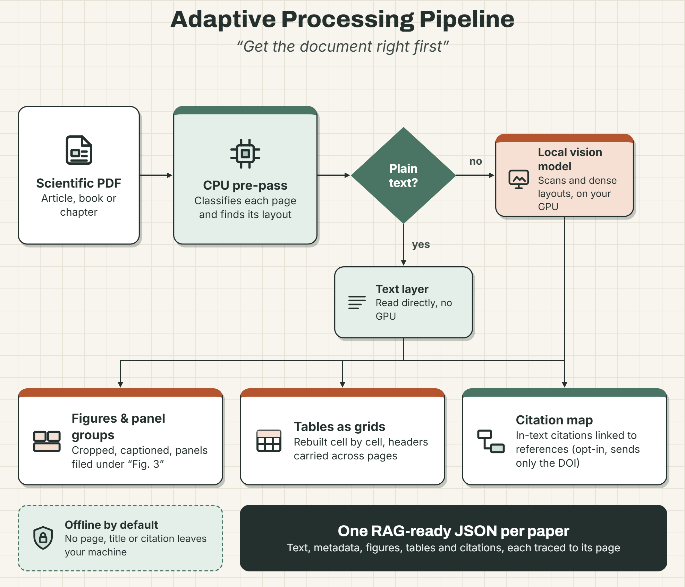
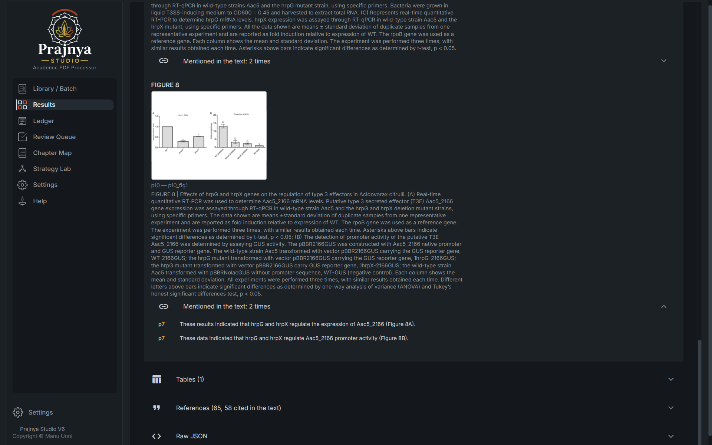
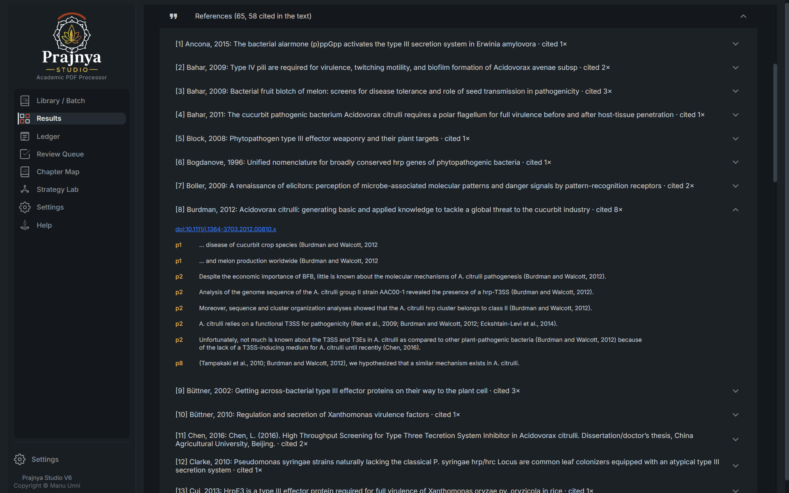
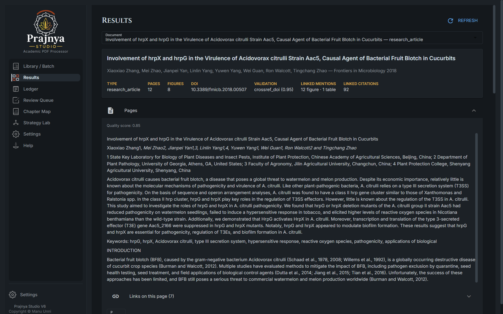

# Prajnya

### Scientific PDF Processing Engine for RAG

   

<p align="center">
  
</p>

**Prajnya turns scientific PDFs into structured JSON you own: the text, verified
metadata, every figure and table as its own object, and the links a reader
follows. "Fig. 3B" points to Figure 3, "Table 2" to its rebuilt grid, and
"(Doi et al., 2005)" to its entry in the reference list. It runs fully offline
on a single 8 GB GPU.**

*prajñā* (Sanskrit): insight, wisdom. Built by a biologist, for researchers.

**What it is for.** AI assistants and other LLM tools answer questions about
research only as well as the material they are given. Retrieval-augmented
generation (RAG) supplies it: a search step pulls the relevant passages,
figures and tables from your library and hands them to the model. Prajnya
builds that library, and does it with AI of its own. A machine-learning layout
model finds figures and tables on each page, and vision-language models read
scans, tables and complex layouts, running locally on one GPU. Its output can
feed:

- an AI assistant that answers from your own papers and shows the figure,
  table or reference behind each claim;
- a searchable literature database, with figures and tables as entries of
  their own;
- tables of results for a review or meta-analysis;
- a citation network: who cites whom, and where in the text;
- training or evaluation data for machine-learning models.

> **«In RAG, what goes in determines what comes out.»**

A paper's claims point at its figures, its tables and other papers. A
retrieval system that drops those pointers can find a sentence but not the
evidence behind it, so Prajnya keeps them.

---

## Contents

[What you get](#what-you-get) · [How it works](#how-it-works) · [Measured](#measured) · [Is it for you?](#is-prajnya-right-for-you) · [Install](#installation) · [Quick start](#quick-start) · [Prajnya Studio](#prajnya-studio) · [Manual](MANUAL.md) · [Citation](#citation) · [Licence](#licence)

---

## What you get

One JSON per document, plus a folder of figure and table crops. Here is what
Prajnya wrote for a real 12-page paper, unedited:
[`contract/examples/frontiers_acidovorax_hrp/`](contract/examples/frontiers_acidovorax_hrp/)
(Zhang et al., 2018, *Frontiers in Microbiology*, CC BY).

**Figures and tables are objects, under the label the paper prints.** Each has
a crop, its caption, its page and a stable ID; panels of one figure are grouped
under one label.

```jsonc
{ "figure_id": "p10_fig1", "printed_label": "FIGURE 8", "label_key": "figure 8",
  "page": 10, "image_path": "figures/PMC5880930/p10_fig1.png",
  "caption": "FIGURE 8 | Effects of hrpG and hrpX genes on the regulation of type 3 effectors…" }
```

Tables carry the same, plus the table rebuilt as an HTML grid, so their
numbers can be searched while the crop stays available to a multimodal model.

**Mentions are linked to those objects, offline.** Every "Figure 8A" or
"Table 1" in the text records where it stands and which object it means:

```jsonc
"mentions": { "figures": [
  { "page_number": 7, "content_offset": 1975, "text": "Figure 8A", "number": "8",
    "targets": ["p10_fig1"] } ], … }
```

The sentence "These results indicated that hrpG and hrpX regulate the
expression of Aac5_2166 (Figure 8A)" therefore leads to Figure 8 through a
direct lookup. Two western blots that look alike are told apart by the text
that cites them.

**Citations are linked to the reference list** (the opt-in `online` level,
which sends only the paper's DOI or title, never its content). Numbered and
author–year styles are both read; one citation can name several entries:

```jsonc
"markers": [ { "page_number": 1, "content_offset": 2413, "kind": "author_year",
               "text": "Schaad et al., 1978, 2008", "numbers": [41, 40] } ],
"references": [ { "position": 40, "first_author": "Schaad", "year": 2008,
                  "doi": "10.1016/j.syapm.2008.09.003", … },
                { "position": 41, "first_author": "Schaad", "year": 1978,
                  "doi": "10.1099/00207713-28-4-621", … } ]
```

**Metadata is verified, not believed**: the title page, the text layer and an
authority (Crossref or your Zotero library) are reconciled, and the source of
each value is recorded.

**Every page says how it was read.** In this paper: the title page by a vision
model, three pages straight from the text layer, the rest by a vision model,
one of them repaired from its table's own crop. Each page also marks its
running heads and page numbers, and gives its running text (`body`) without
them, ready to split into passages.

The full format is a published contract,
[`contract/prajnya_document.schema.json`](contract/prajnya_document.schema.json),
described field by field in the [manual](MANUAL.md#what-you-get).

---

## How it works

<p align="center">
  
</p>

On one GPU, time is the amount of model work, so Prajnya avoids model calls it
does not need. A CPU pass routes each page once: plain prose comes straight from
the PDF's text layer, figures and tables are cropped and read as objects, and
only scans and dense layouts are read by a vision model. One model sits on the
GPU at a time, so 8 GB is enough.

No model name appears in the code. Each job (`extraction`, `title_detection`,
`layout_detector`, …) is bound to a model in configuration, so swapping a
model, or giving one job to a cloud model, is a configuration change.

---

## Measured

Prajnya was benchmarked against leading open-source tools on 40 biology
papers, drawn at random and scored blind against each publisher's own
structured version of the article. It is strongest at finding figures and
tables under their printed labels, reading table structure, and linking in-text
mentions to the right figure or table. It trails on body-text cleanliness,
author order and citation recall for author–year styles, and it is the slowest
of the tools measured.

The benchmark, its protocol and every result are in
[**BENCHMARK.md**](BENCHMARK.md); the code to rerun it is in
[`benchmark/`](benchmark/).

---

## Is Prajnya right for you?

**Use it if** you need scientific PDFs turned into structured data you own, for
a RAG system, a literature database or your own scripts, and especially if the
documents cannot leave your machine. Unpublished, embargoed and licensed papers
often cannot be uploaded to a third party; in the shipped configuration no page,
title or citation leaves your machine.

**It does not (yet):**

- **chunk, embed or retrieve.** It is the ingestion layer; retrieval is the next
  layer's job (Shastrasaara, in development).
- **read anything but PDFs.** No DOCX, HTML or slides.
- **install in one click.** Local mode needs `llama-server` and about 13 GB of
  model weights. Cloud models are optional, per job.
- **race to be fastest.** About 11 s per page on an 8 GB laptop GPU. It would
  rather take longer than hand you a wrong table, caption or citation.

---

## Installation

**Requirements:** Windows 10/11 or Linux; Python **3.10**; for local mode an
8 GB NVIDIA GPU, [llama.cpp](https://github.com/ggml-org/llama.cpp)'s
`llama-server`, and ~13 GB of model weights. In cloud mode no GPU is needed.

```bash
git clone https://github.com/mku1988-oss/Prajnya-Academic-PDF-Processor.git
cd Prajnya-Academic-PDF-Processor

conda create -n prajnya python=3.10
conda activate prajnya
pip install -r requirements.txt
```

Then download the models ([`models/README.md`](models/README.md) lists each
file, its licence and where it goes), tell the launcher where `llama-server` is
(`PRAJNYA_LLAMA_SERVER=/path/to/llama-server` in `.env`), and check the install:

```bash
python run_llama_server.py --check
```

| model | job | licence |
|---|---|---|
| PP-DocLayoutV3 (ONNX) | layout detection, on the CPU | Apache-2.0 |
| GLM-OCR | page reading and tables | MIT / Apache-2.0 |
| olmOCR-2-7B | title pages, scanned fallback | Apache-2.0 |
| DeepSeek-OCR-2 | figure second opinion | Apache-2.0 |

> **A note on names.** **Prajnya** is this engine and **Prajnya Studio** its
> interface. **Shastrasaara** is the larger scientific RAG system it feeds; the
> project began under that name, which is why it remains in the source tree.

---

## Quick start

```bash
conda activate prajnya
python run_llama_server.py                                   # start the model server, leave it running

python -u run_prajnya.py --pdf "paper.pdf"                   # one paper, fully offline
python -u run_prajnya.py --pdf "paper.pdf" --citations online   # ...with its reference list and linked citations
python -u run_prajnya.py --pdf "C:/papers" --recursive --noninteractive   # a folder, unattended

python -u run_prajnya_studio.py                              # or the interface, at http://127.0.0.1:8850
```

Start the server with `run_llama_server.py`, not by hand: it uses the right
paths and keeps one model on the GPU at a time. Results go to `run_outputs/`.
Every option is in the [manual](MANUAL.md#the-command-line).

---

## Prajnya Studio

The same engine in your browser: process a folder, read the results, follow the
links, fix metadata, choose models.

<p align="center">
  
</p>
<p align="center"><em>Every figure with the sentences that mention it, one hop from the text.</em></p>

<p align="center">
  
  
</p>
<p align="center"><em>Left: a table's crop beside its rebuilt grid. Right: the reference list, each entry with the sentences that cite it.</em></p>

<p align="center">
  
  
</p>
<p align="center"><em>Left: verified metadata and link counts. Right: a folder classified on the CPU, before any model runs.</em></p>

Screens: Library / Batch, Results, Ledger, Review Queue, Chapter Map, Strategy
Lab, Settings, Help. What each does is in the [manual](MANUAL.md#prajnya-studio).

---

## Documentation

| | |
|---|---|
| [**MANUAL.md**](MANUAL.md) | how to use it: command line, Studio, local or cloud, books, metadata review, citation levels, the output format, configuration, troubleshooting |
| [**BENCHMARK.md**](BENCHMARK.md) | how it measures up, and how to rerun the benchmark |
| [`contract/`](contract/) | the output schema and real examples |
| [`CHANGELOG.md`](CHANGELOG.md) | what changed in each release |

---

## Citation

If you use Prajnya in your research, please cite:

```bibtex
@software{prajnya2026,
  title   = {Prajnya: A Scientific PDF Processing Engine},
  author  = {Manu Unni},
  year    = {2026},
  version = {6.8.0},
  url     = {https://github.com/mku1988-oss/Prajnya-Academic-PDF-Processor}
}
```

---

## Acknowledgments

Prajnya is built on these projects, all permissively licensed. Full
attributions are in [`NOTICE`](NOTICE).

- **Serving**: [llama.cpp](https://github.com/ggml-org/llama.cpp) · **Interface**: [NiceGUI](https://github.com/zauberzeug/nicegui)
- **PDF & imaging**: [pypdfium2 / PDFium](https://github.com/pypdfium2-team/pypdfium2) · [Pillow](https://github.com/python-pillow/Pillow) · [OpenCV](https://opencv.org/) · [NumPy](https://numpy.org/)
- **Layout**: [PP-DocLayoutV3](https://github.com/PaddlePaddle/PaddleX) (Apache-2.0) via [onnxruntime](https://onnxruntime.ai/)
- **Reading**: [GLM-OCR](https://huggingface.co/zai-org) · [AllenAI olmOCR-2](https://huggingface.co/allenai/olmOCR-2-7B-1025) · [DeepSeek-OCR](https://huggingface.co/deepseek-ai)
- **Metadata**: [Crossref](https://www.crossref.org/) · [OpenAlex](https://openalex.org/) · [Zotero](https://www.zotero.org/) via [pyzotero](https://github.com/urschrei/pyzotero)

---

## Licence

[Apache-2.0](LICENSE). Third-party attributions in [`NOTICE`](NOTICE).

Prajnya ships only permissively licensed components (Apache-2.0, MIT, BSD).
PyMuPDF is AGPL-3.0, so it is not on the shipping path: the default PDF backend
is pypdfium2. PyMuPDF remains an optional backend that is not in
`requirements.txt` and is never required for a run to succeed.
